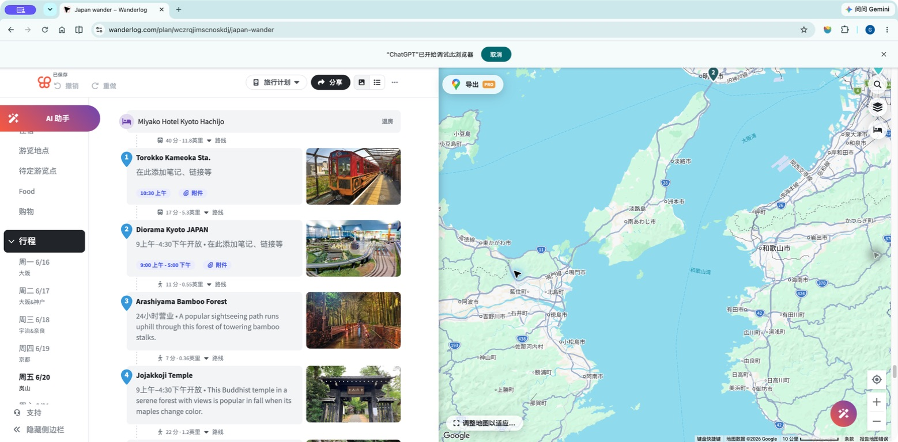
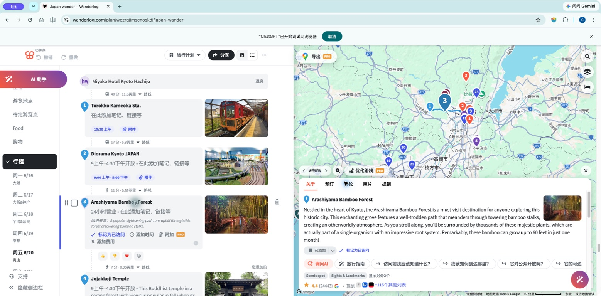

# 行程只读界面：Wanderlog 参考方案

2026-09-12 · 只读界面已在本地实现并检查；尚未部署。下文保留设计依据，验收记录见末尾。

参考：[Japan wander — Wanderlog](https://wanderlog.com/plan/wczrqjimscnoskdj/japan-wander)。已按用户要求，使用电脑操作访问其 Chrome 中现有标签页，浏览日期目录、景点列表和详情。仅借鉴界面组织，不将参考旅行的地点、日期、预订或票价导入本项目。

## 1. 当前范围

网站行程部分只允许查看。成员可以切换日期、查看已有 Plan A/B、展开景点、放大照片、查看路线与预约官网；这些只改变当前浏览状态，不修改正式行程。

不提供拖拽排序、增删地点、修改日期／时长／费用、更换照片、自动优化路线、个人副本编辑或提交合并入口。工程方案中个人副本与合并保留为后续路线图，不属于这次界面范围。领队仍通过既有维护流程更新正式行程，管理员成员管理功能继续独立。

此前已确定的评论功能保留：仅领队正式行程节点可以评论，成员建议对同行成员可见。这里“只读”指行程内容；评论不改变路线，也不进入行程 Markdown。此次不增加点赞、投票或访问打卡。

## 2. 浏览证据与可借鉴部分

### 步骤 1：切换到岚山当天，查看列表与地图

观察：左侧日期目录，中间为编号景点与照片，右侧固定地图；卡片间用细虚线及交通方式、耗时、距离连接。酒店退房作为独立的当天衔接条。列表层次清楚，适合快速浏览。

限制：切换日期后，截图中的地图仍停留在之前的广域位置。因此我们的设计应明确在选择日期后缩放到当天路线，不照搬这一状态。参考图的英里／英尺也不适合我们的旅行展示，统一使用 km／m。

### 步骤 2：点击竹林景点，查看展开详情

观察：选中卡片后右侧显示同名景点详情，地图对应编号放大，列表位置保留；图文对应关系明确。详情覆盖地图下部，长说明和多个按钮会压缩可视范围。

采用卡片和地图联动；正文详细信息优先在卡片内展开，让地图保持足够面积。照片单独放大，关闭后回到原来的卡片与滚动位置。不要复制参考页的编辑工具、推荐广告和第三方用户评论。

这两步浏览正常完成；仅审阅桌面可见状态，未验证参考站手机布局、完整键盘操作、读屏或对比度合规。截图只作为本地设计参考，不作为网站图片素材。

## 3. 我们的页面结构

桌面采用日期目录、行程阅读区、固定路线图三部分。沿用现有网站的颜色和字体，以浅色卡片、轻边框、充足行距组织信息。中等宽度保留较窄日期目录、使用行程／地图切换；手机日期栏横向排列，以行程列表为主，提供“行程／地图”切换，恢复当前选中地点与滚动位置。

每一天按以下顺序展示：

1. 日期、城市、主题与强度；当天住宿、行李安排及重要预约提醒。
2. 当天摘要：当前统计费用合计（JPY／成人）、步行 km、活动额外消耗 kcal；明确热量含景区内部步行和爬坡，注明参考体重。天气仅在有带查询时间的可靠数据时展示，未知不造值。
3. 用户要求的单行时间轴：交通、游览、吃饭、酒店、空闲的圆角色块首尾相接，宽度按时长比例；允许点击查看和定位，不允许拖动或拉伸。手机可横向查看细节，短色块另有可读文字说明。
4. 按时间顺序排列的景点卡片与交通衔接条。
5. 当天费用构成、恢复体力安排、次日城市衔接与备选说明。

### 景点卡片

卡片常显编号、名称、计划时段、一张地点照片、简短游览重点、建议游览时长。成人票价紧接时长下方，例如“成人门票：1,000 JPY／人”；免费、待核实、另购项目明确区分。

开放时段、最晚入场、闭门时刻分开显示，最晚入场不能埋在展开项中。较长的来源、例外和细节可展开阅读。官网／预约／地图导航为独立链接；成员建议入口位于卡片底部，默认显示数量，展开读取讨论。

照片布局与本地静态资源联合验证，见[静态地点照片方案](PLACE-PHOTOS.md)。不把布局硬编码进 Markdown；卡片从 place、stop、ticket 引用读取数据，照片靠同一地点身份匹配。活动稳定 ID 保持不变，防止评论错位。

### 交通与两日衔接

两个景点间单独显示交通方式、总耗时、步行距离和必要的换乘说明；未知值明确待确认。费用只由预算条目加总，卡片或交通条重复展示不重复计费。

当天地图默认仅展示所选日程，编号与卡片一致；同一地点多次经过仍能对应不同活动。全程地图单独展示两日之间从末景点／寄存点／酒店到下一城市酒店／车站的衔接。切换 Plan B 只预览已有备选，不将其保存成成员版本或修改领队决定。

### 费用口径

显示明确的 JPY 单位及每人／全团口径。只计已预订餐厅，未订餐饮不计入，摘要注明“当前统计合计，不含未预订餐饮”。门票主线计入、备选排除；酒店含餐不重复加。网站 API 的 USD 运营费不进入旅行费用。

## 4. 后续实现验收

- 日期、卡片、时间轴和地图选择始终一致；手动浏览地图不被滚动不断抢回视角。
- 手机照片可见，长名称和票价不被裁掉，署名不被遮挡。
- 所有行程修改入口和写入调用均不在本阶段启用；不能只隐藏按钮而留下可调用的成员修改接口。评论与管理员认证行为独立验证。
- 键盘可选择日期、打开卡片与关闭大图；关闭后焦点回原控件。标记除了颜色还包含编号／文字。
- 图片缺失或加载失败时，行程、地图、费用与评论仍可使用。
- 不自动更改已核实开放规则，也不导入 Google 评论替代团队建议。

## 5. 本地实现与检查记录

- 桌面1905px、1280px和手机390px观察：日期／阅读／地图布局、JPY费用、时间轴、门票及入场时段均可阅读；手机当前日期自动进入横向目录可视范围。
- 地点名称和编号定位地图；地图中的“查看行程”回到卡片。手机地图弹窗简化，完整入场说明仍在卡片常显。
- 62 个地点及可选区域均已配图，含车站、酒店、寄存点和备选地点；署名与来源可见，支持点击放大和 Escape 关闭。使用缩略图延迟加载。
- 本地真实认证流程进入隔离测试成员；提交一条本地建议成功，并验证从地图打开全部建议、点击地点回到评论。未向线上发布评论。
- 九个日程版本和全程总览已检查渲染；86个节点保留既有ID，未改路线、时刻、景点或行李安排；37项费用对应新的餐饮口径。
- 构建、类型检查、33项认证／评论测试和部署包 dry-run通过；未执行部署或推送。

尚未完成：其余景点逐一选图、真实设备Safari／读屏全面审计。未来行程编辑和Markdown渲染仍未实现。
