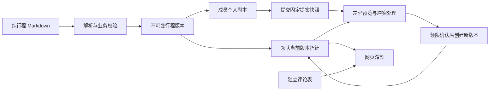

# 行程文档、个人副本与领队合并：工程方案

状态：设计草案，未实施。调研日期：2026-09-12。代码基准：`7065f55`。

新增需求：成人票价显示于景点建议游览时长下方，并纳入每日费用构成。票种保存在地点资料中，费用条目按固定ID引用；主线计入、备选排除、已含交通或住宿的费用不重复累计。已完成网络核价及文档更新，详见 [票价核对记录](TICKET-PRICES.md)，本轮仍未修改现有代码。

本轮仅新增工程文档及纯行程示例，不修改现有程序、依赖、数据库或线上服务。格式细节见 [语言规范](JOURNEY-LANGUAGE.md)，全部现有行程数据见 [行程示例](journey.example.md)。

新增餐饮口径：只计入已预订餐厅。候选、询位中、已取消以及未确定餐厅的日均餐饮预留不进入合计；已订餐厅按对应餐段的Tabelog预算或已订套餐价记录，并标明来源。当前暂无已订餐厅，示例已移除原餐饮预留，保留用餐时间。合计必须注明“不含未预订餐饮”，酒店套餐假设已含的餐食不重复加价。

新增界面范围（2026-09-12）：参考 Wanderlog 的按天图文列表与地图关联，当前网页行程只允许查看；个人副本、编辑与合并属于未来阶段，不在本次界面开放。既有正式行程评论继续保留。见[只读界面方案](ITINERARY-UI.md)及[Google 地点照片方案](PLACE-PHOTOS.md)。

## 1. 决策摘要

采用 **Journey Markdown + 结构化行程模型 + 不可变版本 + 个人副本 + 三方合并审核**。

Markdown 是可阅读、导入、导出和人工编辑的行程表示；前端读取它经校验产生的结构化数据，负责地图、时间轴、费用、地点卡片与布局。文档不含任何可执行代码。

每个成员可从领队已发布的某一版复制个人行程，修改后提交一份固定的提案快照。领队可以选择采纳全部、采纳部分或不采纳。合并前必须同时查看复制起点、领队当前版与成员提案，不能直接覆盖整份文件。

**行程内容与协作信息严格分开：**

| 数据 | 存放位置 | 是否进入行程 Markdown |
| --- | --- | --- |
| 日期、地点、路线、酒店、餐饮、时长、预算、步行与热量、开放信息、A/B方案 | 行程文档；每个版本有对应结构化结果 | 是 |
| 行程节点、地点、活动色块的固定编号 | 行程文档 | 是，是行程实体身份 |
| 评论、评论作者、处理状态、发表时间 | 独立评论表 | 否 |
| 谁拥有副本、从哪版复制、提交状态、审批者、合并冲突 | 副本、提案及版本关系表 | 否 |
| 登录凭证、Passkey、邀请问答、个人资料 | 现有认证存储 | 否 |

初期沿用 **Workers + 现有 TripAuth Durable Object 的 SQLite**。把行程逻辑封装成独立模块、独立表，与认证共处同一个每旅行对象，便于权限复核和合并写入原子完成；不新增常驻服务器、D1、R2 或实时协作服务。跨大量旅行的运营检索出现后再考虑调整。

## 2. 已确定需求与设计假设

### 用户已确定

1. 先写工程文档和技术调研，暂不实施。
2. 以后调整行程只改一份描述文档，网页负责渲染。
3. 未来成员可以修改自己的行程，提交给领队选择是否合并；最新约定是当前界面仅查看，本阶段不启用编辑或提交。
4. 行程文档只包含行程信息，不包含评论。
5. 所有成员只能在领队的行程中评论，所有这些评论对同行成员公开。
6. 保留现有轻量认证、领队 Passkey 与 Cloudflare 部署方式。

### 本方案建议，尚非用户追加授权

- 每个成员先保留一个活动个人副本；草稿默认作者可读写，提交的提案作者和领队可读。此可见性是假设，不改变正式评论的共享规则。
- 修改提案没有讨论串；可以有一次性的提交说明及领队决定说明，作为审核记录保存在协作表。如果产品不需要说明字段，可以取消，不影响行程格式。
- 审核后个人副本仍保留；提交后继续编辑会产生新草稿版本，已提交快照不变。
- 不采纳的内容不会被自动改成评论，也不会自动修改领队行程。
- 第一版不做多人同时编辑同一份草稿，不要求成员学习 Git 或 Markdown；未来用普通表单编辑，底层导出相同文档。

## 3. 当前工程事实与迁移影响

以下来自本地代码检查，而非对线上数据的推测。

| 当前文件／机制 | 现状 | 后续影响 |
| --- | --- | --- |
| `dist/data.js` | 地点、酒店、逐日节点及 Plan B | 迁入 Markdown，保留86个现有节点编号 |
| `dist/estimates.js` | 游览时长、预算与计算函数混合 | 内容迁入文档，计算函数留渲染层 |
| `dist/hours.js` | 开放、截止、闭门及来源 | 内容迁入文档，保留“未确认”状态 |
| `dist/schedule.js` | 时轴数据与绘制混合 | 色块数据迁入文档，颜色与交互留前端 |
| `dist/app.js`、`dist/index.html` | 仍有日期、7天范围、人数、概览路线、备选及酒店接驳硬编码 | 也必须改为从模型派生，仅迁 `data.js` 不足以达成目标 |
| `scripts/build.mjs` | 执行受信任的 JS 行程文件生成资源及评论目标表 | 未来改为解析非可执行文档，不对用户文档执行 `eval` 或 VM |
| `src/comment-targets.ts` | 构建时固定的评论目标白名单 | 在线合并后必须改为从当前正式版本读取，不能等待重新发布 Worker |
| `src/comments.ts` | 以目标编号关联独立评论、保存历史上下文 | 保留独立存储；补充正式版本范围验证及发表时版本信息 |
| `src/worker.ts` | JSON请求体统一最多65,536字节 | 全行程示例约90KB以上，在线文档接口必须单独设计大小上限，不能直接复用原限制 |
| GitHub Actions | 推送 main 自动部署 Worker | 文档阶段不推送，避免触发不必要的生产发布；将来软件发布与行程内容发布分开 |

不能把现有网页直接当作新的通用渲染器。后续实施需要完整清除内容硬编码，并验证跨城路线、两套温泉返程、评论和时间轴全部使用同一版本。

## 4. 技术栈调研与选择

### 4.1 文档与验证

| 选项 | 结论与理由 |
| --- | --- |
| 普通散文 Markdown | 阅读友好，但“下午”“待定”和重复地名无法可靠推导路线、时长、合并对象 |
| Markdown 中的 YAML 结构块 | 推荐；标题方便阅读，结构块提供稳定字段，不引入可执行语法 |
| 整份 YAML / JSON | 能表达相同数据，但缺少 Markdown 文档组织与阅读体验 |
| MDX | 不采用；本需求只要数据，不需要导入组件或执行文档中的代码 |
| CommonMark AST + `remark-parse` | 推荐识别有位置范围的代码块，避免以一条正则处理任意 Markdown；该工具将 Markdown 解析为语法树。[官方说明](https://github.com/remarkjs/remark/tree/main/packages/remark-parse) |
| `yaml` 2.x | 推荐解析结构块；采用 YAML 1.2、禁止自定义标签与别名，保留错误位置。其 Document API 可处理节点和格式，不能把它当成整个 Markdown 的无损编辑器。[官方文档](https://eemeli.org/yaml/) |
| JSON Schema 2020-12 + Ajv | 推荐作为字段契约；严格拒绝未知字段与错误类型，再叠加业务校验。日期、地理坐标与跨实体引用需要明确验证，不能只相信 TypeScript 类型。[规范](https://json-schema.org/draft/2020-12)、[Ajv选型说明](https://ajv.js.org/guide/schema-language.html) |
| Ajv standalone | 在开发／构建阶段预生成验证模块，浏览器和 Worker 使用同一结果，避免在请求期间动态编译 Schema。官方支持输出独立验证代码。[官方说明](https://ajv.js.org/standalone.html) |

建议原有 TypeScript、esbuild、Leaflet、Vitest 和认证依赖继续沿用。新候选依赖并未加入项目；具体版本在实施时核定、锁定，并测试 Node 22、Workers runtime 与浏览器兼容性。此次 `yaml` 调研版本为2.9.1，但不等于整套技术已做运行时验证。

YAML只负责表达值，不支持继承、模板、表达式、脚本或远程包含。任意额外正文不作为隐形业务配置；要渲染的说明必须写入结构字段。格式版本与网站软件版本分离。

### 4.2 Cloudflare存储

| 产品 | 适用性 | 本项目选择 |
| --- | --- | --- |
| Durable Objects + SQLite | 以单个旅行协调当前版本、提交审核与认证检查；支持事务性强一致存储 | 沿用现有实例，增加独立行程模块和表 |
| D1 | 适合独立SQL数据库及跨旅行查询 | 当前没有新增数据库的必要；它本身也能实现事务逻辑，未选择是为了减少迁移和双存储协调 |
| Workers KV | 缓存与读多写少数据，读取有最终一致性 | 不保存正式版本指针、权限或合并锁 |
| R2 | 大型附件、独立备份导出 | 小型文档快照暂不引入 |
| GitHub仓库／PR | 适合开发者维护源代码与文档 | 不要求每位成员注册GitHub，不把每次网页编辑变成代码部署 |

DO的事务与SQL支持已核实；合并采用同步事务API，不能在事务中执行外部请求，不能把“同一DO”误认为跨 `await` 永不交错。[DO存储与事务](https://developers.cloudflare.com/durable-objects/api/sqlite-storage-api/)

KV官方说明跨地点更新可延迟60秒或更久，因此不适合作为本次“当前版本”的权威存储。[KV一致性说明](https://developers.cloudflare.com/kv/concepts/how-kv-works/)

D1也是合理的后续选项，目前官方列出付费单库10GB、免费单库500MB；本项目远不需要凭容量选它。[D1限制](https://developers.cloudflare.com/d1/platform/limits/)

### 4.3 为什么暂不使用实时协作框架

成员是在自己的副本修改，然后提交领队决定，并没有要求所有人同时改同一份文件。Automerge等CRDT工具解决的是并发共享状态与同步，不能替代领队对“去哪、何时出发”的决策。本方案先用版本前置条件和三方合并；未来同一草稿确实需要实时共同编辑时再评估。[Automerge官方介绍](https://automerge.org/docs/hello/)

RFC 6902定义了JSON Patch，包括顺序执行的修改和 `test` 操作，但不定义本项目的三方合并语义。可以对按ID归一化的对象使用补丁思想，不能直接把数组下标补丁当成行程合并算法。[RFC 6902](https://www.rfc-editor.org/rfc/rfc6902)

## 5. 行程内容与版本的唯一来源

### 阶段一：仍由领队通过仓库更新

`journey.md → 解析 → 校验 → Journey Model → 网页资源`

每次发布从唯一 Markdown 生成地点卡片、地图、预算、概览和时间轴。生成结果不能手改；错误构建禁止发布。现有文字快照及开放核对表也应从相同数据派生，消除多处维护。

### 阶段二：开放个人副本与在线合并

此时线上数据库中“当前正式版本指针”成为唯一发布入口。仓库 Markdown 是初始种子／导入文件／导出备份，后续普通CI部署不能重新导入它覆盖线上合并结果。

每个不可变版本保存 `markdown` 及由其解析得到的 `modelJson`，后者是派生缓存。版本还有外部 `schemaVersion`、`parserVersion`、原文散列和规范化模型散列。两者必须在同一次创建中一致；读取发现不一致就报错，不选择任意一份当真相。

网页表单修改结构化数据后，经同一确定性序列化器生成规范 Markdown，再校验、存成新版本。首次导入的原文可原样保留；表单编辑后的导出采用统一排版，不承诺保留任意手写缩进、YAML注释或装饰标题。语义相同的排版调整不应显示为行程变化。

版本号、作者、来源副本、审批记录均在数据库外层，不写进可分享的行程文件。文档中的 `version` 仅指格式版本。

## 6. 固定编号、A/B方案与内容模型

`place.id` 是物理地点身份；`day.id` 是日程单元身份；`stop.id` 是一次活动节点身份；`slot.id` 是时间分配色块身份。它们不依赖当前日期、数组位置、标题或人的名字。

保留 `d1-dotonbori` 等86个既有活动编号。即使名称看起来有Day数字，跨日移动也不重命名。增加另一项活动要生成新编号；同一酒店首日寄存与夜间返回是不同活动节点。

Plan A/B是领队行程内部的路线变体，与成员个人副本是不同概念。示例的前5天被两个方案引用，Day6/7各有自己的日程单元；修改共享日会影响两个方案。审核界面应明确显示影响范围。

所有可独立选择合并的列表项（节点、色块、费用、备选、城市衔接）都需要固定ID。来源链接、纯说明列表等不要求逐条精细合并，第一版可以按整个字段冲突处理。

每日地图来自节点的地点引用及抵达该节点的交通；跨城地图来自 `handoffs` 对实际节点的引用。换酒店必须联动住宿、当日结束、次日出发、行李、接驳和费用；不能仅替换酒店名称。

## 7. 副本、提案和审核流程

1. 成员点击“以领队行程创建我的版本”；服务端复制当前正式版本，并保存不可变 `baseRevisionId`。
2. 成员修改自己的版本，网页持续展示“我的版本”，不开放评论。
3. 保存带 `expectedDraftRevisionId`；两个标签页修改同一草稿时，较旧的保存请求返回409，不用最后一次写入静默覆盖。
4. 提交时固定 `submittedRevisionId` 和基准版。以后继续编辑草稿不会改变领队正在审核的提案。
5. 领队看到结构化差异及对相邻两天、A/B方案、路线、时长、预算和体力的影响。
6. 领队选择修改组，处理冲突，得到完整候选行程；校验通过才允许确认。
7. 确认时复核领队身份、近期Passkey、当前正式版本与提案状态，并在一个事务里创建版本、更新指针和决定记录。
8. 合并成功后用户重新读取正式版本；旧个人副本不自动覆盖或丢失，可显式基于最新正式版同步。

提案状态建议为 `submitted → merged / partially_merged / rejected / withdrawn / closed`。草稿另有自己的保存状态；冲突是某次预览的结果，不是永久提案状态。部分采纳后关闭该次提案，未采纳部分可以重新基于新版提交，避免一个提案重复执行相同修改。

## 8. 三方合并和部分采纳

三个输入均为不可变版本：

- **B（Base）**：成员复制或最近一次显式同步的正式版本。
- **C（Current）**：领队当前正式版本。
- **P（Proposed）**：该次提交的成员快照。

先按实体ID归一化为映射，按字段比较值；格式和注释不参与语义差异。缺失字段使用独立的“缺失”标记，不能与 `null` 混淆。

| 比较 | 默认结果 |
| --- | --- |
| P = B | 成员没有改，保留C |
| C = B，P不同 | 可采纳P |
| P = C | 双方已一致，无需重复修改 |
| 三者不同且修改同一字段 | 冲突，领队选择或编辑合成值 |
| 一方删除，另一方修改同一实体 | 冲突，不能自动删除 |
| 双方同一ID新建不同内容 | 冲突；服务端不能按名称猜身份 |
| 双方修改同一有序列表的次序 | 第一版保守标记顺序冲突，不以数组下标覆盖 |
| 不同实体的独立字段各自修改 | 可合并，但仍需整个行程校验 |

例如，原版海边停留90分钟，成员改120分钟，领队仍90分钟，可采纳成员修改。若领队已经改60分钟，应展示“90 → 60／120”的冲突。不能因为提案提交较晚就采用120。

**无字段冲突不等于行程可行。** 一方延长午饭，另一方提前末班车返程，即使修改不同字段，合起来也可能赶不上车。候选结果必须重新算时间与引用关系，提示交通预留、最晚入场及休息影响。

部分采纳以“有依赖的修改组”为单位。例如新增景点至少包含地点资料（如新增）、节点、出入交通、时间轴和费用影响；删除酒店必须解决次日出发引用。领队可以只采纳该组的某些文字，但无法提交悬空引用或负时长的候选行程。跨日移动不能被拆成“从旧日删除”与“向新日增加”两个相互独立的批准项。

第一版对自然语言段落做整字段冲突，不实现字符级自动拼接。顺序变化使用固定ID列表与前置版本比较；对同时插入、移动或删除的复杂情况要求领队确认完整候选顺序。

### 防止预览过期和重复提交

预览返回一个带有效期的服务端预览记录，绑定 `baseRevisionId/currentRevisionId/submittedRevisionId/selectionHash/resolutionHash/candidateHash`。确认携带预览ID与 `idempotencyKey`。

若确认时当前版或选择内容发生变化，返回409并要求重新预览；不能拿旧结果覆盖新版。相同幂等键和相同请求返回原结果，不重复建版本；相同键而请求内容不同返回409。存储失败时整笔事务回滚。

事务内不做网络请求或异步哈希。需要提前计算的工作在事务前完成，进入事务后重新检查所有相关指针、提案状态及权限，防止计算期间发生更新。客户端提交的作者、管理员身份及“已通过校验”字段一律不可信。

## 9. 评论范围：只在领队当前行程

**成员个人副本、已提交提案、差异预览均没有评论入口和可写评论接口。** 即使个人副本里的节点编号与正式版相同，也不能把副本视图变成另一个可评论页面。

服务端创建评论只接受正式行程作用域：根据登录会话确定旅行与作者，从服务端当前正式版本查找目标节点，并检查客户端所见的 `expectedOfficialRevisionId`。客户端伪造副本ID、提案ID或传入未被采纳的新节点时拒绝请求。

鉴于原页面可能未及时刷新，正式版本已变化时先返回409让用户更新上下文再发送。成功评论记录 `officialRevisionIdAtCreation + targetId + contextSnapshot`，正文和作者只在评论表，永不写入Markdown。

| 情况 | 评论行为 |
| --- | --- |
| 领队正式版现有节点 | 全部有效成员可评论、可互相查看 |
| 领队正式版中的A/B路线 | 都属于正式行程，可分别评论其节点 |
| 成员新增节点，尚未采纳 | 不可评论 |
| 成员副本里复制的既有节点 | 该视图不展示评论；可跳转正式版对应节点再评论 |
| 既有节点改时间或跨日移动 | 保留原节点ID，原讨论沿用；显示发表时上下文，避免把旧建议误认成新时段建议 |
| 既有节点被移除 | 历史讨论在正式行程的“全部建议”归档中只读，不在旧版本继续评论 |
| 新活动合并进入正式版 | 从合并成功后开放评论 |
| 成员被移除 | 继续现有撤销会话／邀请、删除资料和匿名化评论行为；同时关闭其未完成提案，清除或匿名化协作表中的作者关联 |

不会为每个副本复制评论，也不会把提案说明当成评论。评论权限、是否已处理等不参与行程三方合并。

迁移既有评论时保留原ID、正文、目标编号和已存的context快照。此前没有记录的发表时版本不能凭空补造：可将版本来源标为legacy／未知；只有迁移后的新评论才记录准确的正式版本ID。

## 10. 存储草案

下列是拟议逻辑表，不是本轮已创建的数据表。表名和字段可在实施评审时细化。

| 表 | 主要字段／约束 |
| --- | --- |
| `journey_revisions` | id、format_version、parser_version、markdown、model_json、source_hash、model_hash、created_at；内容不可变 |
| `journey_official` | trip_id主键、current_revision_id；一旅行一个正式指针 |
| `journey_drafts` | id、owner_id、base_revision_id、head_revision_id、updated_at；活动副本按成员唯一 |
| `journey_proposals` | id、draft_id、base_revision_id、submitted_revision_id、submitted_by、status、submitted_at、result_revision_id |
| `journey_decisions` | id、proposal_id、reviewed_current_id、selected_changes、resolutions、result_revision_id、actor_id、created_at；若有说明也在此处 |
| `journey_revision_parents` | revision_id、parent_revision_id、relation；支持合并的多来源关系，置于文档之外 |
| `journey_previews` | id、输入版本、选择／解决方案散列、候选散列、expires_at；短期记录 |
| `journey_requests` | actor_id、operation、idempotency_key唯一、payload_hash、result、expires_at |
| `journey_targets` | revision_id、target_id唯一、day_id、plan_ids、place、time；派生索引，随版本写入 |
| 现有 `comments` | 独立表保留，增加发表时正式版本与历史上下文语义 |

建议完整快照起步，不先采用长链补丁存储。五人团队的数据量小，快照更容易恢复、预览与校验；模型是缓存而非第二个可独立编辑的来源。长期备份必须与提案基准、评论历史一同保留引用关系。

行程业务回滚创建一个引用旧内容的新正式版本，保留审核历史。不要通过回滚整个认证DO数据库来撤销行程，否则可能恢复旧会话、旧邀请或已删除成员。平台级灾难恢复与行程版本回退是不同操作。

正式版与被提案基准引用的历史不自动删除。未提交草稿版本可以设置明确保留策略；触及容量限制时先停止新增并导出，不静默删除必要历史。

## 11. 接口草案及权限

所有接口沿用登录Cookie、同源要求、参数验证与限流；以下接口尚不存在。

| 接口 | 访问者 | 意义 |
| --- | --- | --- |
| `GET /api/journey` | 所有有效成员 | 当前正式版本元信息和模型，私有响应 |
| `GET /api/journey/export` | 所有有效成员 | 导出当前正式版纯Markdown |
| `POST /api/journey/drafts` | 所有有效成员 | 基于服务端当前正式版创建自己的副本 |
| `GET /api/journey/drafts/:id` | 作者；提交后领队通过提案读快照 | 查看个人版本 |
| `PUT /api/journey/drafts/:id` | 作者 | 带 expectedRevisionId 保存，不能修改他人副本 |
| `POST /api/journey/proposals` | 副本作者 | 冻结当前草稿版本并提交 |
| `GET /api/journey/proposals/:id` | 作者及领队 | 提案内容及审核结果，无评论 |
| `POST /api/journey/proposals/:id/preview` | 领队 | 三方差异、选择修改组、解决冲突并校验 |
| `POST /api/journey/proposals/:id/merge` | 近期Passkey验证的领队 | 原子合并，版本前置条件＋幂等 |
| `POST /api/journey/proposals/:id/reject` | 领队 | 不采纳并记录状态 |
| `POST /api/journey/proposals/:id/withdraw` | 提案作者 | 在未合并时撤回 |
| `POST /api/journey/import` | 近期Passkey验证的领队 | 导入Markdown为待审候选，不能直接覆盖正式版 |
| `POST /api/journey/rollback` | 近期Passkey验证的领队 | 预览通过后将旧内容作为新正式版发布 |
| 原评论接口 | 所有有效成员 | 仅当前正式版目标可发表，个人副本／提案范围拒绝 |

提案合并不授予成员管理员权限。成员被移除后，其旧浏览器即使持有副本ID也不能读写或提交；合并尚未完成的提案时再次检查作者有效性和关闭状态。

## 12. 容量、限制与安全边界

拟议应用限制：单份Markdown原文最多256KiB、规范化模型最多256KiB、文档导入JSON请求最多1MiB；仅文档相关接口放宽，邀请、认证与评论仍保持原限制。还需限制结构深度、实体数量和单字段长度，避免“字节不多但结构极复杂”的输入。

原文及模型的单行总字节数含额外字段建议不超过1MiB，低于官方SQLite单字符串／BLOB／行2MB上限。当前DO限制页对免费单对象容量的总表与FAQ表述存在差异（总表10GB，FAQ免费1GB），因此本方案不以该数字承诺可用容量；实施时以账户计划与最新确认信息为准。[DO限制](https://developers.cloudflare.com/durable-objects/platform/limits/)

容量估算采用工程预算而非报价：若一份版本约100KB原文＋100KB模型，500份快照约100MB，另加索引与历史。第一版按旅行总存储预留上限、保存去抖和历史策略控制增长，不每敲一个字就建版本。

费用按Worker请求、DO计算时间、存储读写和空间计量；五人低频使用预计负载小，但未读取账户账单、未压测，不能承诺零费用。避免无用户活动时高频轮询；先用保存后刷新、页面重新可见时刷新和手动刷新。[DO官方价格](https://developers.cloudflare.com/durable-objects/platform/pricing/)

输入处理要求：拒绝重复YAML键、别名、合并键、自定义标签、未知字段、无效链接协议与原型相关危险键。源码块解析为数据，说明文本按纯文本渲染；不执行HTML、MDX、JavaScript或远程include。远程URL仅作链接，不由后端任意抓取；未来天气／地图查询另用受控服务集成。

正式行程、个人副本、导出及审核预览均不经过公共缓存。日志不记录完整行程正文、评论、问答、Cookie或邀请token。导出文档只遍历白名单行程模型，不能将数据库记录整包序列化。

未来天气数据应存放在独立的短期观测／预测缓存，带查询时间和有效期；当前文档可以保存天气相关行程约束，不把过期预报视作正式计划。天气建议不能自动发布，仍走领队审核。

## 13. 分阶段实施与验收

本阶段只交付文档，不执行以下步骤。

### 阶段一：纯行程文档与渲染

实施解析器、Schema、业务校验和序列化器；一次性从当前代码迁入正式Markdown；动态生成导航、概览、路线、开放时间、费用、热量与时间轴。保留认证和评论行为。

验收：86个旧节点编号完整保留；7天9个日程版本及A/B跨城衔接一致；逐项比对地点、交通、开放信息、时间轴和预算；成人票价位于游览时长下方，票价调整能同步影响卡片与每日费用；核查重复经过、免费、未知价、渠道选择、备选和套餐包含的计费；验证未订／询位／取消餐厅不计费，已订但未知价不当0，午晚餐正确匹配及部分成员用餐人数不叠乘；修改一份文档可更新所有视图；代码中不再含需要重复维护的旅行数据。格式错误不能生成可发布资源。

以下阶段二至四为未来能力设计，当前只读界面不实现这些入口或成员行程写入接口。

### 阶段二：线上版本与个人副本

行程转为数据库不可变版本和正式指针；一次性种子导入后，CI不再覆盖内容。新增个人副本保存与提交；评论目标从正式版本动态生成。

验收：副本不会影响正式版；越权副本读写失败；并发保存409；已提交快照不随草稿变化；正式评论与任何个人副本彻底隔离；发布软件不重置行程。

### 阶段三：审核和三方合并

实现按ID差异、依赖修改组、冲突预览、确认前置条件、幂等及版本回退。必要的Passkey复核沿用既有管理模式。

验收至少包含：不同字段自动组合、同字段冲突、删除与修改冲突、跨日移动、双方顺序改变、共享A/B日程变更、部分采纳后悬空引用、过期预览、重复点击合并、事务中途失败、提案作者刚被移除，以及旧评论在节点改期／删除后的正确展示。

### 阶段四：易用编辑与导入导出

在现有网站内加编辑表单和差异审核页。成员通过拖动、时间和地点选择完成修改，系统生成相同描述文档。不要求开发一个独立后台管理系统；是否更换前端框架待实际界面复杂度证明有需要时再定。

## 14. 实施前仍需验证的技术项

- 解析器、预编译Schema验证器在Node22、Workers runtime和浏览器的相同结果与包体积。
- 256KiB边界文档的解析和三方比较CPU时间、失败输入限制以及DO事务时间；限额是设计预算，尚未性能验证。
- 当前86节点、所有时间槽和费用的迁移回归，以及跨页／A/B评论上下文。
- 中文输入、手机表单、长日程保存冲突和领队审核操作的可用性。
- 原始Markdown导入与规范化导出的稳定性；以模型等价作为验收，不承诺字节相同。
- 免费DO容量文档差异、账户实际额度与目标发布时依赖版本。

这些是后续实施任务，不是本轮未完成的线上改动。当前建议已足以确定架构方向：纯行程文件、独立协作存储、正式版评论、个人副本与受控合并。
