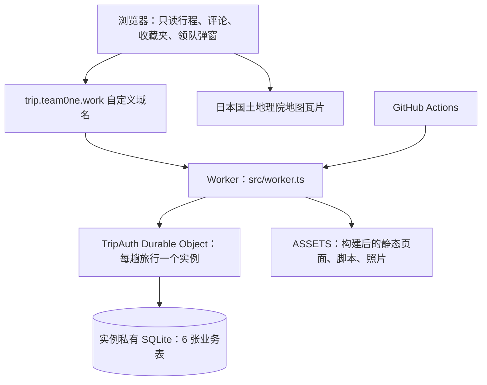

# 关西旅行网站：技术架构与数据字典

更新日期：2026-09-13。用途：在其他会话中同步项目现状、开发约束、Cloudflare 架构、接口和全部业务数据库字段。

本文根据当前工作区 `src/`、`web/`、`dist/`、`scripts/`、`wrangler.jsonc`、`package.json` 和 GitHub Actions 配置逐项整理。描述的是**实际代码实现**，不是未来方案。本文不包含密钥、Cookie、成员真实资料或真实邀请链接。

## 1. 接手时首先确认

| 项目 | 当前信息 |
| --- | --- |
| 开发目录 | `/Users/team0ne_m/Code/japan_journey_site/kansai-cloudflare-source` |
| 私有 GitHub 仓库 | `team0ne1/japan-journey-site` |
| 正式域名 | `https://trip.team0ne.work/` |
| Worker 名称 | `kansai-private-journey` |
| 旅行标识 | `kansai-october-2026` |
| 当前分支及提交基线 | `main`，`c8169cc`（增加宇治旅游参考链接） |
| 当前本地增量 | 小红书搜索入口；共享探店收藏夹、地区分组、营业时间待确认、可选消息来源、CSV 导出、感兴趣表态；均为未提交工作区内容 |
| 验证记录 | 上一轮构建、类型检查、48 项运行时测试通过；Chrome 本地验证表态、取消和名单，CSV 本地接口验证通过。本轮仅整理文档，未重新执行测试 |
| 发布约束 | **用户要求讨论期间只保留本地修改；收到明确发布指令后才提交／推送／部署。推送 main 会自动部署，不能把 push 当成单纯备份** |

本轮没有查询 Cloudflare 当前部署版本；不能把本地 HEAD 或工作区等同于线上版本。用户之前已完成正式部署，但最新本地收藏夹等功能尚未由本会话发布。正式版本需在获准发布时结合 GitHub Actions 和 Cloudflare 部署记录确认。

正式行程对所有用户（包括领队）只读。用户只能在领队正式行程节点评论；收藏夹允许共同新增和表态，但不会自动改变正式行程。Markdown 行程描述语言、个人行程副本、提案与合并机制仍属于未来设计，未接入运行时。行程 Markdown 不应包含评论、身份或表态数据。

注意：页面写“5人同行”，当前代码限制是**最多 5 个成员账户，另有 1 个领队**，不是强制总人数等于 5。不要据此把表态人数上限硬编码为 5。

## 2. Cloudflare 组件与请求链路

| 组件 | 配置／实现 | 用途和边界 |
| --- | --- | --- |
| Cloudflare Workers | `src/worker.ts` | 唯一 HTTP 入口；检查域名、请求方式、来源、JSON 大小、Cookie；路由 API、提供受保护静态内容 |
| Workers Static Assets | `assets.directory=.build/assets`，绑定 `ASSETS` | 与 Worker 一起发布 HTML、JS、CSS、照片等；`run_worker_first=true` 确保资源先经鉴权 |
| Durable Objects | 绑定 `TRIP_AUTH`，类 `TripAuth`，实现 `src/auth.ts` | 通过 `getByName(TRIP_ID)` 定位实例；同一旅行的邀请、会话、评论、收藏共享协调和事务边界 |
| Durable Object SQLite storage | `ctx.storage.sql`、`transactionSync()` | 持久化全部业务数据；不是 D1，不是单独启动的数据库服务，也不是 Workers KV |
| Worker 自定义域名 | `routes: trip.team0ne.work, custom_domain:true` | 正式入口；应用另以 `APP_ORIGIN` 验证规范来源 |
| Worker Secrets／变量 | `AUTH_SECRET` 等，见后文 | 平台保存运行时配置；不把秘密写入代码或网页 |
| Workers Observability | 日志启用、调用日志关闭；Tracing 启用、采样率 0.01 | 代码记录简短事件名及操作路径，不记录答案、令牌和评论正文；这里只确认仓库配置，不代表查询过线上日志 |
| Wrangler | 版本 `4.131.1` | 本地模拟、生成类型、打包预检、发布；使用现有 Worker 与 DO 绑定 |

没有接入：Cloudflare Pages、D1、Workers KV、R2、Queues、Cron Triggers、Workflows、Turnstile、Cloudflare Access、Agents SDK、WebSocket 推送。`TripAuth` 的 `get/put` 是作者封装的 SQLite 操作，**不是 KV 产品绑定**。没有专门的后台管理站点；领队管理 UI 是同一网页的弹窗。

`workers_dev=true`，但 Worker 会拒绝与 `APP_ORIGIN` 不符的来源并返回 421；`preview_urls=false`。静态资源 `html_handling=none`、`not_found_handling=none`，页面映射由 Worker 明确控制。

DO 初始迁移标签为 `v1`，`new_sqlite_classes:["TripAuth"]`。增加业务表在构造函数中执行 SQL，不需要为每张表创建新的 DO 类、命名空间或 D1 数据库。

## 3. 技术栈和文件职责

| 技术／文件 | 当前用途 |
| --- | --- |
| HTML、CSS、原生 JavaScript | 页面及互动；未采用 React、Vue、Next.js，也没有 ORM |
| TypeScript `~5.9.3` | Worker 与存储逻辑；最终安装版本以 `package-lock.json` 为准 |
| Node.js | 项目要求 >=22；GitHub Actions 使用 22 |
| `@simplewebauthn/browser` `14.0.0` | 浏览器发起 Passkey 注册与认证 |
| `@simplewebauthn/server` `14.0.1` | 验证 WebAuthn challenge、签名、Origin、RP ID、用户验证 |
| Web Crypto API | 随机令牌、SHA-256、HMAC-SHA-256、AES-GCM |
| Leaflet `1.9.4` | 本地 vendor 文件；路线点位、编号、图层、卡片联动 |
| 日本国土地理院 GSI pale | 浏览器请求 `https://cyberjapandata.gsi.go.jp/xyz/pale/{z}/{x}/{y}.png`；保留地图署名 |
| Google Maps URL | 地点搜索和逐段步行／公共交通导航链接；不是 Google Maps JS／Places 付费 API |
| 小红书搜索 URL | 原地点名称（中文或英文）两次 `encodeURIComponent` 后放入 `search_result_ai?keyword=`；仅外链跳转 |
| 静态 JPEG 照片 | `dist/photos/` 及缩略图；来源与许可元数据在 `dist/place-images.js`；不是 Google 图片搜索抓取接口 |
| esbuild `0.28.2` | 打包、压缩 `web/auth.js`、`comments.js`、`favorites.js` |
| Vitest `4.1.11`、`@cloudflare/vitest-plugin` `1.1.8` | 在 Workers 运行时测试认证、评论、收藏夹与 SQLite 行为 |
| `cbor-x` `1.6.0` | Passkey 测试夹具使用的 CBOR 编码工具 |
| `@types/node` `^22.0.0` | 开发时 Node 类型声明 |
| GitHub Actions | PR 检查，main 推送或手动触发后检查和发布 |

| 文件 | 职责 |
| --- | --- |
| `src/worker.ts` | HTTP 安全边界、资源鉴权、CSV 下载响应 |
| `src/auth.ts` | `TripAuth`、认证记录、邀请管理、成员管理和业务分发 |
| `src/crypto.ts` | 加密与答案标准化 |
| `src/comments.ts` | 正式行程评论、删除、处理状态与限流 |
| `src/favorites.ts` | 收藏创建、地区排序、URL 校验、兴趣表态、CSV |
| `src/favorite-regions.ts` | 前后端共享地区 ID、显示名和顺序 |
| `src/comment-targets.ts` | 构建生成的合法评论节点表；不要手工改生成结果 |
| `src/env.d.ts` | 在 Wrangler 生成的 `Env` 上增加运行时配置字段 |
| `web/auth.*` | 登录／邀请／初始化页面、账号栏与领队管理弹窗 |
| `web/comments.*` | 评论输入、列表、全部建议、定位回行程 |
| `web/favorites.*` | 收藏夹表单、地区卡片、表态按钮与名单 |
| `dist/data.js` | **当前实际行程数据源**：地点、日程、酒店及 Plan B；包含稳定 `commentId` |
| `dist/estimates.js` | 建议时长、每日费用组成等规划参考 |
| `dist/hours.js`、`hours-guide.md` | 开放、最晚入场、结束时间及来源 |
| `dist/schedule.js` | 每日横向单行时间轴的数据 |
| `dist/tickets.js` | 成人门票及引用信息 |
| `dist/app.js`、`style.css`、`itinerary-ui.css` | 地图、日期／方案切换、卡片和布局 |
| `dist/place-images.js`、`place-photos.js` | 照片元数据、显示与放大 |
| `scripts/build.mjs` | 验证照片与评论编号，生成节点白名单，组装 `.build/assets` |
| `docs/JOURNEY-*.md`、`journey.example.md` | 未来 Markdown 行程方案及示例，不是生产解析器或数据库 |

地图连线是交通方式与先后顺序示意，不是精确道路路径。日期／Plan A/B／收藏夹选择放在 URL hash，不修改服务器上的行程。尚无天气 API、自动调整、在线预订、成员个人行程编辑或合并。

## 4. 运行配置与凭证

| 名称 | 类型／位置 | 含义 |
| --- | --- | --- |
| `TRIP_ID` | Wrangler vars | 旅行实例标识；修改会定位到不同 DO 实例，旧数据不会自动迁移 |
| `APP_ORIGIN` | Dashboard 运行时变量 | 正式应为 `https://trip.team0ne.work`，无尾斜杠；决定规范域名、POST Origin 和 WebAuthn RP ID。仅 localhost 允许 HTTP 开发 |
| `AUTH_SECRET` | Worker Secret | 43 字符 Base64URL 令牌；签名问答答案、IP 摘要，并派生待领取邀请的加密密钥 |
| `SETUP_SECRET` | Worker Secret | 初次绑定领队和人工恢复时使用的 43 字符凭证 |
| `ADMIN_RECOVERY_ENABLED` | 运行时变量 | 只有字符串 `true` 才启用恢复接口，常态应关闭 |
| `ASSETS` | 平台绑定 | 静态资源 Fetcher |
| `TRIP_AUTH` | 平台绑定 | DurableObjectNamespace，指向 `TripAuth` |
| `CLOUDFLARE_API_TOKEN` | GitHub Actions Secret | CI 发布凭证；不进入浏览器，也不是登录用的 `AUTH_SECRET` |
| `CLOUDFLARE_ACCOUNT_ID` | CI 环境配置 | 发布账户标识，非秘密；具体值见现有发布工作流 |
| `compatibility_date` | Wrangler | `2026-09-12` |
| `compatibility_flags` | Wrangler | `nodejs_compat` |
| `keep_vars` | Wrangler／发布参数 | 保留 Dashboard 管理的变量；实际升级仍需核对变量和 Secret 是否完整 |

不要随意轮换 `AUTH_SECRET`：已存答案 MAC 和尚未领取的邀请密文依赖它，轮换需要明确的数据迁移／重建方案。会话令牌本身使用独立 SHA-256 哈希，改变 `AUTH_SECRET` **并不会自动撤销全部旧会话**。不要用修改 Secret 代替显式注销会话。

Passkey 私钥和生物识别数据保存在用户认证器／凭证提供商中，服务器仅保存公钥等注册信息。跨设备可用性取决于凭证是否同步或支持跨设备认证，而不是单纯登录同一个 Chrome 账号。

## 5. 数据库存储总览

每个 `TRIP_ID` 对应一个 `TripAuth` SQLite 数据库，应用拥有 6 张业务表。所有业务时间戳均为 **Unix 毫秒**；没有另加时区字段。显示时按页面需要格式化（例如收藏日期使用 `Asia/Tokyo`）。

| 表 | 用途 | 主键／关键索引 |
| --- | --- | --- |
| `records` | 通用 JSON 认证记录 | `key` 主键；`record_expiry(expires)` |
| `comments` | 正式行程评论 | 自增 `id`；唯一 `(author,request)`；`comment_thread(target,deleted,id)`；`comment_review(deleted,resolved,id)` |
| `comment_rates` | 成员评论操作限流 | `author` 主键 |
| `favorites` | 共享探店地点 | 自增 `id`；唯一 `mapsUrl`；唯一 `(author,request)` |
| `favorite_rates` | 成员新增收藏限流 | `author` 主键 |
| `favorite_interests` | 地点兴趣表态 | 联合主键 `(favoriteId,author)`；`favoriteId` 引用 `favorites(id)`，声明 `ON DELETE CASCADE` |

SQLite 因 AUTOINCREMENT 会维护内部 `sqlite_sequence`，其中 `name` 为自增表名、`seq` 为当前序列值；它不是业务表，不应手工修改。平台可能另有内部系统结构，本表单只描述仓库管理的 schema。

成员存在于 `records` 的 JSON 中，所以 `author` 没有 SQL 外键指向成员表；删除／匿名化由代码事务完成。不要把展示姓名当主键，同名成员可以存在。

### 5.1 `records` 的物理字段

| 字段 | SQLite 类型／约束 | 含义 |
| --- | --- | --- |
| `key` | TEXT PRIMARY KEY | 带前缀的记录标识，如 `member:<id>`、`session:<hash>` |
| `value` | TEXT NOT NULL | `JSON.stringify` 后的数据；具体结构取决于 key，见以下完整字典 |
| `expires` | INTEGER NOT NULL DEFAULT 0 | 记录有效期；0 表示不过期。读取条件为 0 或大于当前时间 |

有效期是应用实现的，不是 SQLite 自动 TTL。认证限流路径会执行过期记录清理；无常驻定时任务或 alarm。即使过期行尚未物理删除，`get/all` 也不会把它当作有效记录。

### 5.2 `records.value`：领队和成员

| key | JSON 字段 | 含义 |
| --- | --- | --- |
| `leader` | `created:number` | 领队初始化时间；这是“已设置领队”的标记，不保存密码，`expires=0` |
| `member:<id>` | `id:string` | 成员稳定随机 ID，43 字符 Base64URL |
| 同上 | `name:string` | 显示名，输入去首尾空白，最多 40 字符 |
| 同上 | `question:string` | 邀请验证问题，最多 160 字符 |
| 同上 | `answerMac:string` | 标准化答案的 HMAC；输入域为 `answer:<memberId>:<normalizedAnswer>`，不保存明文答案 |
| 同上 | `inviteHash?:string` | 当前邀请原始 token 的 SHA-256 Base64URL 哈希，指向邀请记录 |
| 同上 | `generation:number` | 邀请代次；新成员创建首张邀请后为 1，每次替换递增 |

成员记录 `expires=0`，直到领队显式移除。答案最多 200 字符；标准化流程为 NFKC → 去首尾空白 → 连续空白合并成一个空格 → 按 en-US 小写化。生日没有专用 DATE 字段，性别、笔画数也没有独立列；当前只是领队设置的单个问题及答案。

### 5.3 `records.value`：邀请

key 为 `invite:<tokenHash>`，物理 `expires` 与 JSON `expires` 一致。

| 字段 | 类型 | 含义 |
| --- | --- | --- |
| `memberId` | string | 邀请对应的成员 ID |
| `generation` | number | 创建邀请时的成员邀请代次 |
| `status` | `active / used / revoked` | 可兑换、已成功兑换、已撤销 |
| `failures` | number | 该邀请答错次数；达到 5 次即失效并替换 |
| `expires` | number | 到期时间，创建后 7 天 |
| `pending` | 可选 string | 仅供领队一次领取的新邀请 token 密文；AES-GCM，格式为 `Base64URL(iv).Base64URL(ciphertext+tag)`；IV 12 字节，成员 ID 是 additionalData |

原始 token 是 32 字节安全随机值（256 bit，Base64URL 后 43 字符）。领队领取链接、邀请使用或撤销时会删除 `pending`，以后不能再次读取原链接，只能重新生成。邀请有效还要求成员存在、成员 `inviteHash` 指向这条记录、状态 active 且失败次数未耗尽。

链接形如 `/invite#token=<原始token>`。hash 不随首次页面请求发送；前端随后在同源 POST body 中提交 token。错误达 5 次时，服务端生成下一代邀请供领队领取，绝不把替代 token 返回给失败请求者。这是“邀请失效＋重建”，并非永久封禁成员账户；已登录浏览器不会因此自动退出。

### 5.4 `records.value`：会话

key 为 `session:<SHA-256(rawCookieToken)>`。JSON `expires` 与物理 `expires` 一致。

| 字段 | 类型 | 含义 |
| --- | --- | --- |
| `userId` | string | 成员 ID，或领队固定值 `leader` |
| `role` | `leader / member` | 权限角色 |
| `expires` | number | 创建后 30 天到期；当前不是每次访问滑动续期 |
| `verifiedAt` | number | 领队最近一次 Passkey 认证时间；成员为 0。管理敏感操作要求 5 分钟内认证 |
| `created` | number | 此次会话创建时间 |

浏览器 Cookie 名为 `__Host-trip_session`，属性为 `Path=/; Secure; HttpOnly; SameSite=Lax; Max-Age=2592000`，不设置 Domain。JS 不读会话 Cookie，不在 localStorage 保存登录凭证。新登录替换当前浏览器旧会话，不会默认退出其他浏览器。

### 5.5 `records.value`：Passkey 与挑战

| key | JSON 字段 | 含义 |
| --- | --- | --- |
| `passkey:<credentialId>` | `id:string` | WebAuthn credential ID |
| 同上 | `publicKey:string` | 凭证公钥的 Base64URL 编码 |
| 同上 | `counter:number` | 签名计数器，交给 SimpleWebAuthn 校验，成功后更新 |
| 同上 | `transports?:string[]` | 经白名单过滤的认证器传输提示：ble、hybrid、internal、nfc、usb、smart-card |
| 同上 | `name:string` | 领队填写的凭证备注，最多 60 字符，默认“我的 Passkey” |
| 同上 | `created:number` | 注册时间；Passkey 记录自身不过期 |
| `challenge:<随机ID>` | `challenge:string` | WebAuthn 挑战值 |
| 同上 | `kind:setup/register/login` | 初始化注册、追加凭证、登录 |
| 同上 | `sessionHash:string` | 绑定创建挑战时的浏览器会话哈希；未登录时通常为空 |
| 同上 | `setupHash?:string` | 初始化时绑定 `SETUP_SECRET` 的 SHA-256，防止配置改变后继续使用旧挑战 |
| 同上 | `name?:string` | 注册成功后保存的 Passkey 备注 |

挑战有效期 5 分钟，存放在物理 `records.expires`；挑战 JSON 本身不含 expires。验证前检查 kind、会话绑定并消费挑战，一次性使用。最多 5 个 Passkey；要求 resident key 和 user verification，attestation 为 none，允许算法 -7 / -257。Origin 取 `APP_ORIGIN`，RP ID 为其 hostname。

### 5.6 `records.value`：限流与恢复标记

| key | value | 含义／有效期 |
| --- | --- | --- |
| `rate:ip:<HMAC>` | `{count:number, until:number}` | 每个 IP 摘要 10 分钟最多 90 次进入认证限流路径的调用；不存原始 IP，物理 expires=until |
| `rate:trip` | `{count:number, until:number}` | 整趟旅行同一路径 10 分钟最多 500 次；物理 expires=until |
| `used-setup:<SHA-256(secret)>` | JSON 布尔值 `true` | 初始化／恢复已用凭证标记，防止重复恢复；expires=0 |

`count` 为窗口内调用数，`until` 为固定窗口结束时间。`/api/session`、成员列表读取、评论和收藏夹分支在认证总限流前返回，所以**90／500 不是所有 API 共用的速率限制**。评论、收藏新增有各自限流；感兴趣状态写入目前没有额外频率桶，但要求有效登录、合法地点及同源请求。

## 6. 评论表完整字段

### `comments`

| 字段 | 类型／约束 | 含义 |
| --- | --- | --- |
| `id` | INTEGER PRIMARY KEY AUTOINCREMENT | 评论编号，也用于倒序游标分页 |
| `target` | TEXT NOT NULL | 稳定的行程 `commentId`，必须在构建生成的 COMMENT_TARGETS 白名单内 |
| `author` | TEXT NOT NULL | 服务端根据会话赋值的成员 ID／leader；移除成员后替换为 `removed:<随机token>` |
| `name` | TEXT NOT NULL | 评论时的显示名快照；移除成员后为“已移除成员” |
| `role` | TEXT NOT NULL | 评论时角色快照，用于展示；不是后续操作的授权依据 |
| `body` | TEXT NOT NULL | 评论正文，去首尾空白，最多 1000 字符；删除时清空为 `''` |
| `created` | INTEGER NOT NULL | 创建时间 |
| `resolved` | INTEGER NOT NULL DEFAULT 0 | 0 待处理，1 已处理；只有领队可设置 |
| `deleted` | INTEGER NOT NULL DEFAULT 0 | 0 可见，1 删除墓碑；不物理删行，避免迟到重试重新创建评论 |
| `request` | TEXT NOT NULL | 客户端 requestId，16–64 字符，字母／数字／下划线／连字符；与 author 联合唯一 |
| `context` | TEXT NOT NULL | 评论创建时的节点快照 JSON，包含下表四个字段 |

`context` JSON 字段：`day:number` 为日程编号；`plan:string` 为 A／B／shared；`place:string` 为地点显示名；`time:string` 为节点时间文案。当前节点仍存在时 API 优先使用新白名单上下文；节点消失后使用快照并返回 `archived=true`，旧讨论不丢失。

API 的 `canDelete`、`canResolve`、`archived`、`next` 是动态计算字段，不是数据库列。所有登录成员可读全部讨论；本人和领队可以删除，只有领队可标记已处理。每页 30 条，查询第 31 条判断是否还有下一页。上限为每节点 500 条、全旅行 10000 条，**包括删除墓碑**。

### `comment_rates`

| 字段 | 类型／约束 | 含义 |
| --- | --- | --- |
| `author` | TEXT PRIMARY KEY | 被限流的成员 ID 或 leader |
| `count` | INTEGER NOT NULL | 此窗口已执行的评论新增／删除／处理状态操作次数 |
| `until` | INTEGER NOT NULL | 窗口结束时间，首次操作起 10 分钟 |

窗口最多 30 次；重复新增请求命中幂等记录时不重新占额度。移除成员时删除对应限流行。

## 7. 收藏夹表完整字段

### `favorites`

| 字段 | 类型／约束 | 含义 |
| --- | --- | --- |
| `id` | INTEGER PRIMARY KEY AUTOINCREMENT | 地点编号，表态关联此值 |
| `title` | TEXT NOT NULL | 地点名称，最多 120 字符，保留用户中文／英文原名称 |
| `hours` | TEXT NOT NULL | 营业时间说明，最多 500 字符，可多行；选择待确认时存文字“待确认” |
| `mapsUrl` | TEXT NOT NULL UNIQUE | 经 URL 解析标准化后的 Google 地图 HTTPS 链接；全收藏夹按 URL 去重 |
| `author` | TEXT NOT NULL | 服务端认定的创建者 ID／leader；移除成员后匿名化 |
| `name` | TEXT NOT NULL | 创建者显示名快照；移除成员后为“已移除成员” |
| `created` | INTEGER NOT NULL | 添加时间 |
| `request` | TEXT NOT NULL | 新增请求幂等 ID，16–64 字符，与 author 联合唯一 |
| `region` | TEXT NOT NULL DEFAULT 'unassigned' | 地区枚举 ID，见下表；老数据默认待分类 |
| `sourceUrl` | TEXT NOT NULL DEFAULT '' | 可选消息来源 HTTP／HTTPS 链接，最多 2048 字符；无来源存空串 |

必填项：地区、名称、营业时间、Google Maps 链接。`hoursMode` 仅为前端单选状态，不是数据库字段。`sourceUrl` 不限定平台，可以是 Bilibili、小红书、大众点评、YouTube 或普通网页；拒绝非 HTTP(S) 协议及含用户名密码的 URL，不抓取或嵌入内容。

`mapsUrl` 最多 2048 字符，拒绝非 HTTPS、凭证或非默认端口；允许指定 Google 域名的 `/maps` 路径、`maps.google.com`／`maps.google.co.jp`、`maps.app.goo.gl`、`goo.gl/maps/`。后端不请求、展开或确认地点真实性。同店不同分享链接不一定能去重。

| 顺序 | region ID | 显示名 |
| --- | --- | --- |
| 1 | osaka | 大阪 |
| 2 | kyoto | 京都 |
| 3 | uji | 宇治／城阳 |
| 4 | nara | 奈良 |
| 5 | kobe | 神户／有马 |
| 6 | wakayama | 和歌山 |
| 7 | other | 其他地区 |
| 8 | unassigned | 待分类 |

列表先按地区、同地区按 id 倒序；使用白底卡片，以蓝、绿、棕色系边框区分地区，不因表态人数移动位置。最多 500 个地点，读取和导出覆盖全部条目。没有编辑、删除、自动加入正式行程或收藏评论接口。

### `favorite_rates`

| 字段 | 类型／约束 | 含义 |
| --- | --- | --- |
| `author` | TEXT PRIMARY KEY | 新增收藏的成员 ID／leader |
| `count` | INTEGER NOT NULL | 本窗口新增收藏次数 |
| `until` | INTEGER NOT NULL | 首次操作后 10 分钟的窗口结束时间 |

最多 30 次／10 分钟；相同 author/request 的一致重试返回原 id，不重复插入或扣额度。不一致重试返回 409。移除成员时删除该行。

### `favorite_interests`

| 字段 | 类型／约束 | 含义 |
| --- | --- | --- |
| `favoriteId` | INTEGER NOT NULL，联合主键第 1 列、外键 | 对应收藏地点 `favorites.id` |
| `author` | TEXT NOT NULL，联合主键第 2 列 | 表态成员 ID／leader，由服务端会话确定 |
| `name` | TEXT NOT NULL | 表态时的成员显示名；再次设置 true 时更新为当前姓名 |

有一行就表示此人感兴趣；没有行就是未表态，不保存 `false` 行，不记录表态时间。每人每地点最多一行。添加收藏不会自动表态。

请求传明确的 `interested:true/false`：true 使用 UPSERT，false 删除该用户该地点行，网络重试不会重复计数或反向切换。成员移除时清除其所有表态。`revoke` 只撤销登录和邀请、保留成员资料，因此会保留历史表态；`remove` 才删除成员与表态。

API 返回的 `interested:boolean`（当前用户）、`interestCount:number`（行数）、`interestNames:string[]`（姓名列表）均为计算字段，不另存计数列。名字相同仍按不同成员 ID 分别计数。名单当前按内部 author 排序，不表示投票先后。前端按钮只显示粉红心形、背景为白色；成员以胶囊型标签直接显示在按钮后，完整显示姓名、不截断，空间不足时换行，人数在行末靠右；其他成员新表态在重新打开收藏夹或刷新列表时读取，没有实时推送。

## 8. CSV 导出约定

`GET /api/favorites/export` 下载 `trip-favorites.csv`，响应 `Content-Type: text/csv; charset=utf-8`，`Content-Disposition: attachment; filename="trip-favorites.csv"`。

一条地点记录对应一个 CSV record，字段依次为：

1. 地区
2. 地点名称
3. 营业时间
4. Google 地图链接
5. 消息来源链接
6. 添加者
7. 感兴趣人数
8. 感兴趣成员

采用 UTF-8 BOM，记录之间 CRLF；每个单元格双引号包裹，内含双引号加倍，保留多行营业时间。没有来源／成员时留空；无人表态人数为 0；名单用“、”连接。空收藏夹仍导出表头。地区与组内顺序和页面一致，颜色不在 CSV 内保存。

以 `= + - @` 开头（允许前置空白）的单元格加英文单引号，降低 Excel 将用户文本解释为公式的风险；此处理仅影响导出，不修改数据库原文。CSV 面向阅读／分析，不是回写协议，目前没有导入接口。

## 9. HTTP API 清单

所有路径都是同域 `/api/...`。下表 GET 之外全部为 POST JSON；写请求要求 Origin 等于 `APP_ORIGIN`，拒绝 `Sec-Fetch-Site: cross-site`，Content-Type 为 application/json，请求体最多 65536 字节。后端不信任客户端提供的 name、author、role 来授权。

| 方法／路径 | 权限 | 输入与用途 |
| --- | --- | --- |
| GET `/api/session` | 可匿名 | 返回 user 或 null、setupRequired；user 含 name、role、expires、fresh |
| POST `/api/setup/options` | 初始化凭证 | setupSecret、可选 name；申请首次 Passkey 注册 |
| POST `/api/setup/verify` | 有效初始化挑战 | challengeId、response；注册领队并发会话 |
| POST `/api/passkey/options` | 可匿名 | 申请已有领队 Passkey 登录 challenge |
| POST `/api/passkey/verify` | 有效登录挑战 | challengeId、response；验证并换发领队会话 |
| POST `/api/invite/info` | 有效邀请 token | 返回成员名、问题、剩余次数、到期时间 |
| POST `/api/invite/verify` | 有效邀请及答案 | token、answer；成功兑换 30 天会话 |
| POST `/api/logout` | 当前 Cookie | 删除当前会话并清 Cookie |
| GET `/api/admin/members` | 领队 | 返回成员邀请状态、会话数、Passkey 基本信息；不返回答案 MAC／公钥／令牌 |
| POST `/api/admin/member/create` | 领队且 5 分钟内 Passkey | name、question、answer；创建成员及待领取邀请 |
| POST `/api/admin/invite/rotate` | 同上 | memberId；可同时传新 answer、question；替换邀请，不撤销已有登录 |
| POST `/api/admin/invite/claim` | 同上 | memberId；一次解密并领取邀请 URL |
| POST `/api/admin/member/revoke` | 同上 | memberId；撤销全部会话和当前邀请，保留资料和共享数据 |
| POST `/api/admin/member/remove` | 同上 | memberId；删除资料、全部邀请和会话，匿名化评论／收藏并删除表态和限流记录 |
| POST `/api/admin/passkey/options` | 同上 | 可选 name；申请添加备用 Passkey |
| POST `/api/admin/passkey/verify` | 同上及注册挑战 | challengeId、response；保存新凭证并消耗近期管理验证窗口 |
| POST `/api/admin/passkey/delete` | 同上 | id；不可删除最后一个；删除后退出领队所有会话 |
| POST `/api/setup/recover` | 恢复开关及新恢复凭证 | setupSecret；清空领队 Passkey、challenge、领队会话和初始化标记，保留成员和旅行共享数据 |
| GET `/api/comments/summary` | 已登录 | 按 target 返回 total、open，及 canResolve |
| GET `/api/comments` | 已登录 | 可选 target、before、status=all/open；返回分页评论 |
| POST `/api/comments/create` | 已登录 | target、body、requestId |
| POST `/api/comments/delete` | 评论作者或领队 | id；清空正文、保留墓碑 |
| POST `/api/comments/resolve` | 领队 | id、resolved:boolean；无需额外 Passkey step-up |
| GET `/api/favorites` | 已登录 | 所有收藏地点、当前用户表态及全体名单 |
| POST `/api/favorites/create` | 已登录 | region、title、hours、mapsUrl、可选 sourceUrl、requestId |
| POST `/api/favorites/interest` | 已登录 | favoriteId、interested:boolean |
| GET `/api/favorites/export` | 已登录 | 完整 CSV 快照 |

常用错误：400 输入／验证失败，401 无登录或邀请答案错误，403 权限／来源／step-up，404 对象不存在，409 重复或状态冲突，410 邀请已不可用，429 限流，503 配置或服务异常。认证错误有 code；评论和收藏错误分别统一为 COMMENT_ERROR、FAVORITE_ERROR，配合 HTTP 状态判断。429 响应 Retry-After=600。

“所有人可见”指所有已登录旅行成员，**不是互联网匿名公开**。管理员角色只存在于服务端会话；收藏表态、评论和导出仍须有效 Cookie。

## 10. 页面访问和安全边界

- `/login`、`/invite`、`/setup` 映射到 auth.html；auth.js、auth.css、favicon.svg 可匿名读取。
- 已登录浏览器再次访问 `/login` 或 `/invite` 会跳转到 `/#`，清除邀请片段，使用现有会话进入行程。成功使用过的邀请不能给另一台未登录浏览器重复兑换。
- `/` 未登录跳转 `/login`；其他非公开静态资源未登录返回 401。JS 数据、照片、Markdown 快照、HEAD 和条件请求都先经过 Worker，不可只保护首页。
- 响应统一 private/no-store、no-referrer、nosniff、DENY、noindex/nofollow/noarchive、HSTS。CSP 限制脚本同源、连接同源，图片额外允许 GSI；禁用相机、麦克风、地理位置，允许同源 Passkey。
- 前端评论和收藏文本安全渲染；外链新开窗口并设置 noopener/noreferrer。成员填的来源链接不会在后端抓取，因此没有服务端解析短链功能。
- 登录有效不代表管理窗口一直有效：领队敏感管理操作需 5 分钟内 Passkey 验证；普通查看、评论处理、收藏操作不要求再次验证。
- 普通重新生成邀请不退出成员的已登录浏览器；撤销／移除成员才清除其全部会话。
- 管理恢复必须显式开启恢复开关、配置未用过的新 SETUP_SECRET，再调用恢复并重新初始化；不要擅自重置生产数据。

## 11. 构建、迁移、测试和发布

### 构建

`npm run build` 执行 `scripts/build.mjs`：读取 `dist/data.js` 和照片元数据，验证每个地点照片及 JPEG 文件；验证每个 stop 的 commentId 唯一合法；生成 `src/comment-targets.ts`；复制 dist 和 web 样式，打包前端模块到 `.build/assets`；注入认证、评论、收藏脚本；从产物移除 `.openai`。

**不要直接把 dist 当作公开站点发布。** 原 Sites 历史配置不参与当前 Cloudflare 发布。`.build` 为生成结果，不作为手工修改入口。

### Schema 升级

构造函数使用 CREATE TABLE/INDEX IF NOT EXISTS。收藏表通过 PRAGMA table_info 检查缺列，分别补 `region DEFAULT 'unassigned'` 和 `sourceUrl DEFAULT ''`；新增兴趣表初始为空。普通代码部署不会重建现有 DO 数据库，不要删绑定／类／TRIP_ID 来“刷新数据库”。

保留评论稳定 commentId；替换景点但复用旧编号可能把旧讨论关联到错误地点。删除节点不会自动删历史评论，列表用 context 快照标识归档。

### 检查命令

| 命令 | 作用 |
| --- | --- |
| `npm ci` | 按锁文件安装依赖 |
| `npm run build` | 生成并验证静态构建产物和评论节点 |
| `npm run types` | Wrangler 生成绑定类型 |
| `npm run typecheck` | TypeScript 无输出检查 |
| `npm test` | Vitest Workers 运行时测试，当前 48 项 |
| `npm run dry-run` | Wrangler 只打包预检，不发布 |
| `npm run check` | build → types → typecheck → test → dry-run |
| `npm run dev` | 构建后启动本地 Wrangler；需本地变量／Secret 配置 |
| `npm run smoke` | 正式站点登录与私有资源保护检查 |
| `npm run package` | 生成迁移交付包 |
| `npm run deploy` | **真实发布**：build 后 Wrangler deploy，需用户明确授权 |

测试文件：auth.test.js、comments.test.js、favorites.test.js；Passkey 测试夹具在 passkey-fixture.js。收藏测试覆盖重复新增、URL 校验、地区迁移、CSV 特殊字符／公式处理、并发表态去重、取消、对象回收后持久化、移除成员和权限边界。

当前本地预览曾使用 `http://localhost:8792`，隔离配置和数据在 `/private/tmp/journey-ui-local/`。其中有标注“本地测试”的假地点，不能作为真实行程或同步到生产。临时目录／服务可能随机器状态消失，接手时先检查，不依赖其永久存在。不读取或分享临时 Cookie 文件内容。

### GitHub Actions

- `.github/workflows/verify.yml`：针对 main 的 PR 执行 npm ci 和 npm run check；同 PR 新检查可取消旧检查。
- `.github/workflows/deploy.yml`：main push 或 workflow_dispatch 触发；verify 通过后 deploy，使用 GitHub production environment。发布队列 `production-worker` 不取消进行中的部署。
- 发布作业重新构建，使用 GitHub Secret CLOUDFLARE_API_TOKEN 调用 `wrangler deploy --keep-vars`，部署信息包含 commit SHA，然后执行 smoke。
- Actions checkout/setup-node 固定到提交 SHA；checkout 不保留 Git 凭证；工作流权限 contents:read。
- 用户尚未要求发布时，不 commit/push、不手动触发部署工作流、不调用 npm run deploy。

## 12. 接手检查清单及后续边界

1. 先读本文，核对 git status、HEAD 和用户最新要求，保留现有未提交修改。
2. 改行程目前仍修改 dist 数据；不要误以为 Markdown 解析已接通。
3. 新增业务功能优先复用每趟旅行的 DO，但保持独立表和权限校验。
4. 不把公开可见名单理解为匿名访问；不把 role/name 从浏览器直接写成权限身份。
5. 更改表结构需兼容既有记录，补迁移与对应测试；不需要重复开 D1。
6. 确认范围后运行相关检查；只有明确发布授权才走 CI。
7. 本文应随 schema／接口变化更新；旧设计文档可能是历史快照，实际代码与本文标记的时间为核对起点。

进一步阅读：[收藏夹实现](FAVORITES.md)、[未来行程工程设计](JOURNEY-ENGINEERING.md)、[未来描述语言](JOURNEY-LANGUAGE.md)、[部署说明](../DEPLOY-CLOUDFLARE.md)、[自动发布说明](../AUTOMATED-DEPLOY.md)、[安全说明](../SECURITY.md)。

Cloudflare 官方语义参考：[SQLite 存储 API](https://developers.cloudflare.com/durable-objects/api/sqlite-storage-api/)、[Workers Static Assets](https://developers.cloudflare.com/workers/static-assets/)、[Wrangler 配置](https://developers.cloudflare.com/workers/wrangler/configuration/)。项目实际启用项以本文引用的仓库配置为准，不据产品能力推断已接入功能。
