# 关西七日行程｜路线图

**大阪第一晚已预订（2026-09-23用户确认）：Sugata Hotel Osaka Shinsaibashi, Series by Marriott。** 按本行程10月1日入住、10月2日退房，1晚；地址大阪市中央区南船場2-6-25。订单房型、餐食、价格待补充，不将历史筛选条件当作订单明细。第一天先到酒店寄存／入住再游览，第二天由此退房赴京都；入住前寄存具体条件待酒店核实。[酒店官网](https://www.marriott.com/en-us/hotels/osass-sugata-hotel-osaka-shinsaibashi-series/overview/)。

**住宿全局设定（2026-09-19 更新）：4 位成人、2 间房，默认每间 2 位成人。** 后续所有酒店／温泉住宿查询采用此条件，覆盖此前订房人数口径；房型、预算及历史报价说明见[《酒店选择》](酒店选择.md)。

**大阪第一晚已预订（2026-09-23 用户确认）：Sugata Hotel Osaka Shinsaibashi, Series by Marriott。** 按第一天行程记录为 **2026 年 10 月 1 日入住、10 月 2 日退房，1 晚**；沿用 4 位成人、2 间房，实际订单房型、床型、餐食、价格及取消条款待补充。地址：**〒542-0081 大阪府大阪市中央区南船場2-6-25**；[Google Maps 导航](https://www.google.com/maps/search/?api=1&query=Sugata+Hotel+Osaka+Shinsaibashi+2-6-25+Minamisenba+Osaka)／[酒店官网](https://www.marriott.com/en-us/hotels/osass-sugata-hotel-osaka-shinsaibashi-series/overview/)。地址及酒店资料沿用[酒店选择](酒店选择.md)中 2026-09-18 的调研记录。第一天到店与返回、第二天出发节点均已替换；原 Cross Hotel 的接驳距离和时间不再适用，机场到店及赴京都交通详情待核对。游览顺序保留。

**有马住宿更新（2026-10-12）：第五天改为陶泉 御所坊（Tocen Goshoboh）。** 地址：〒651-1401 神戸市北区有馬町858；[酒店官网](https://goshoboh.com/)／[Google Maps](https://www.google.com/maps?cid=12036972434981022728)／[官方交通与接送](https://goshoboh.com/access/)。有马温泉站步行约4分钟，亦可到站后致电078-904-0551联系接送，服务时段及等候另核。第五天奈良游览取件后赴御所坊，第六天从御所坊退房，拟寄存后步行逛小镇、午餐，再回酒店取件赴神户；退房后寄存条件待确认。入住15:00起，含餐最晚到店时刻另核；地久房型10:00前退房，中庸、天乐11:00前退房。原酒店晚餐和接送时刻不沿用。

**京都住宿已预订：Cross Keys（Airbnb），按本行程为 10 月 2 日入住、10 月 4 日退房，共两晚。** 民宿地址：〒605-0981 京都市東山区本町2丁目89（89 Honmachi 2-chome, Higashiyama-ku, Kyoto）；[民宿地址导航](https://maps.app.goo.gl/mKWuRX7oUZYGHuEw6)。**办理入住先去对面的 [Breakfast “the kind” 咖啡厅](https://maps.app.goo.gl/FL4xS4HgDQhL79P18)**（本町2丁目84-2），不要把两处地址混用。联系电话：+81-90-3710-5869。

**地图定位说明（2026-09-21核对）：** 房东短链接指向 Breakfast “the kind”，坐标 **34.9937865, 135.7698649**，作为第2天正式入住接待点。Cross Keys住宿及行李交接仍在对面本町2丁目89号，2026-09-23核实用户地图链接的建筑地址点为 **34.9937824, 135.769695**，Place ID为 `ChIJLSyMi7cIAWARPlYqhGaEXw4`；标点及分段导航独立使用民宿地址点，不混用咖啡馆位置，具体入户门按房东指引。入住由房东带往客房；旁边的the kind kyoto商店与Tomi Kintsugi工作室不是额外入住地点。

入住 **16:00–21:00**，退房 **10:00 前**，均为日本当地时间；按房东要求，**最迟 10 月 1 日告知预计入住时间**。入住前、退房后可寄存，行李交接点已确认就在Cross Keys民宿，早晚可用时段另核；住宿税另以现金支付，金额待房东告知。4位成人、2晚民宿价格合计 **3,349.99 CNY（人民币）**；实际房间／寝具配置待补充。完整说明见[酒店选择文档](酒店选择.md)。

**跨城交通原则（2026-09-28）：** 不以价格为限制，优先最快的可执行方式，以含接驳、候车、换乘的门到门时间比较。第二天已选定新干线：Yamato办理寄送后赴新大阪站 → 东海道新干线指定席至京都站 → 衔接岚山各方案；到新大阪的出租车／地铁接驳及具体班次待核，未订票。中转车站只写交通详情，不新增图中节点或分支。

**京都段调整：** 第 2 天Sugata退房后步行到Yamato南船场2丁目营业所办理寄送至Cross Keys，再轻装赴新大阪，乘新干线至京都并衔接岚山；寄送成功后返程不再专程回京都站取件，在 16:00–21:00 到the kind cafe办理入住，前往 Cross Keys 休息；第 3 天从 Cross Keys 出发并返回；第 4 天出游前先退房寄存，去伏见稻荷后取件，再赴 JR 宇治。住址变更后，旧版Cross Keys的接驳时长／费用失效，需重算。第 4 天改用清水五条—京阪伏见稻荷往返，取件后经东福寺换 JR 奈良线；[清水五条官方车站资料](https://www.keihan.co.jp/traffic/station/161/info.html)／[东福寺 JR 换乘说明](https://www.keihan.co.jp/traffic/station/153/info.html)。图中不增加交通方式平行分支，景点与游览顺序保留。

**第一天晚餐方向：梅田商圈，餐厅待选。** 酒店放行李后依次参考通天阁、でんでんタウン／日本橋筋商店街、难波八阪神社、黑门市场，再接道顿堀，经法善寺、心斋桥、中崎町到梅田；晚饭后按兴致前往梅田蓝天大厦・空中庭园展望台，再返回Sugata；不设固定到达时间。

**第一天弹性安排（2026-09-23用户确认）：** 图中地点作为当天可选游览清单，箭头仅供顺路参考，不是固定执行顺序；不排严谨时间表，不要求全部完成。先到Sugata安顿行李，之后按精神、天气和兴致决定去哪及停留多久；店铺营业与观景台最晚入场只作实际可行性边界，不为赶点增加焦虑。

2026 年 10 月 1 日—7 日。实线表示既有路线，虚线表示可选或尚待衔接的路线。

**第 5–7 天住宿更新（日期更正）：** 第五天（10 月 5 日）奈良游览后取行李，直接前往有马入住陶泉 御所坊；不在奈良过夜。第六天（10 月 6 日）退房，恢复有马小镇午餐后到三宫／元町、须磨海边及可选 Venus Bridge 的原游览顺序，第六晚神户市区酒店待选。第七天从神户赴关西机场。此前有马住宿安排已由本次更新替代。具体换乘保留在交通资料，未重新核实具体日期班次与到店时间；“奈良直接赴有马”表示途中不增加游览或住宿，不表示无需换乘。

**第二天行李更新（2026-09-28）：** Sugata退房后先步行至[Yamato Transport Co., Ltd. Minamisemba 2-Chome Center／南船场2丁目营业所](https://maps.app.goo.gl/k2vg6ihkhX5cRfcf7)，拟寄送行李到当晚Cross Keys。官网列平日08:00开门、京都当日配送10:00截止，10/2为周五；用户已提供配送先：〒605-0981 京都市東山区本町2丁目84-2（Kyotoshi Higashiyamaku Honmachi 2chome84-2），收件人 冨浪喜久子 Tominami Kikuko，电话09037105864。配送至84-2号，住宿仍在对面89号；收件时段及当日承运仍须确认。路线图按寄送成功安排；错过南船场10:00截止时，携行李到新大阪駅東口営業所，在11:30前完成办理（日本时间；建议11:00前到店，另留排队、填单及称重时间），办妥后返回新大阪站乘新干线。该点京都配送20:00起送达，须确认84-2号收件处可晚间代收，并随身携带当天所需用品。若也错过11:30或目的地无法接收，再携箱到京都站寄存、返程取回；不自动改翌日配送。 [新大阪东口营业所地图](https://maps.app.goo.gl/ZFMx9ELH2VjUvqA4A)；[官方营业所表](https://www.kuronekoyamato.co.jp/ytc/scn/send/services/baggage-branch-list/pdf/same-day_delivery.pdf)。京都配送为普通宅急便运费另加1,100 JPY／件，后备只记交通行李资料，不另画分支。[Yamato大阪当日配送说明](https://www.kuronekoyamato.co.jp/ytc/promotion/baggage_osaka/ja/index.html)。旧版寄存及赶船倒排失效，需把步行、08:00后柜台办理及跨城交通重新计入。

第二天完整保津川游船路线命名为“高精力版本”，为全队可选支线：选择后从京都站乘JR至龟冈站，北口步行至乘船场，不乘小火车；游船回岚山，下船后徒步向北至爱宕念佛寺，首选打车下山；各条路线在the kind cafe办理入住时合并；寄送成功后京都站仅为可能的交通中转，不安排取件；经JR嵯峨岚山站返程的走法记入交通详情。

第二天另设“究极懒人”支线：若在大阪睡醒较晚，在大阪办理寄送、抵达京都后从京都站直接打车到爱宕念佛寺；若晚起错过南船场10:00截止，优先携箱到新大阪东口营业所11:30前办理（20:00起送达，晚间代收待确认），仍不能寄送再用京都站寄存，跳过小火车和游船，在寺院接回鸟居本→落柿舍→竹林→渡月桥的下行路线。

节点仅列游览、住宿、入住办理及行李寄存／寄送地点；普通中转车站和巴士站不单列，交通方式与换乘写入资料文件。车站仅在实际承担寄存或取件时保留；观光小火车以游览项目节点保留。东大寺及南大门仅为备选。大阪 Sugata、京都 Cross Keys 按既有记录；有马住宿地点改为陶泉 御所坊，具体方案待确认。编辑时遵循[《行程路线图维护规则》](行程路线图维护规则.md)。

```mermaid
flowchart TD
    subgraph day1["第 1 天｜10 月 1 日"]
        direction TB
        d1_01["关西国际机场"]
        d1_03["Sugata Hotel Osaka"]
        d1_tsutenkaku["通天阁"]
        d1_nippombashi["でんでんタウン／日本橋筋商店街"]
        d1_nambayasaka["难波八阪神社"]
        d1_kuromon["黑门市场"]
        d1_06["道顿堀・戎桥"]
        d1_05["法善寺横丁"]
        d1_04["心斋桥筋"]
        d1_nakazaki["中崎町"]
        d1_umeda["梅田商圈"]
        d1_skybuilding["梅田蓝天大厦・空中庭园展望台"]
        d1_07["Sugata Hotel Osaka"]
        d1_01 --> d1_03
        d1_03 --> d1_tsutenkaku
        d1_tsutenkaku --> d1_nippombashi
        d1_nippombashi --> d1_nambayasaka
        d1_nambayasaka --> d1_kuromon
        d1_kuromon --> d1_06
        d1_06 --> d1_05
        d1_05 --> d1_04
        d1_04 --> d1_nakazaki
        d1_nakazaki --> d1_umeda
        d1_umeda --> d1_skybuilding
        d1_skybuilding --> d1_07
    end

    subgraph day2["第 2 天｜10 月 2 日"]
        direction TB
        d2_01["Sugata Hotel Osaka"]
        d2_yamato["Yamato 南船场2丁目营业所（寄送行李）"]
        d2_04["嵯峨野观光小火车"]
        d2_06["爱宕念佛寺"]
        d2_07["嵯峨鸟居本"]
        d2_08["落柿舍"]
        d2_09["岚山竹林"]
        d2_10["渡月桥"]
        d2_checkin["the kind cafe"]
        d2_11["Cross Keys"]
        d2_kamo["鸭川"]
        d2_12["八坂神社"]
        d2_13["花见小路"]
        d2_14["祇园白川"]
        d2_16["Cross Keys"]
        d2h_board["保津川漂流（保津川游船）"]
        d2h_land["保津川游船岚山下船场"]
        d2h_togetsu["渡月桥"]
        d2h_bamboo["岚山竹林"]
        d2h_rakushisha["落柿舍"]
        d2h_toriimoto["嵯峨鸟居本"]
        d2h_otagi["爱宕念佛寺"]
        d2_06 --> d2_07
        d2_07 --> d2_08
        d2_08 --> d2_09
        d2_09 --> d2_10
        d2_11 --> d2_12
        d2_12 --> d2_13
        d2_13 --> d2_14
        d2_yamato -.->|备选·究极懒人| d2_06
        d2_checkin --> d2_11
        d2h_board -.-> d2h_land
        d2h_land -.-> d2h_togetsu
        d2h_togetsu -.-> d2h_bamboo
        d2h_bamboo -.-> d2h_rakushisha
        d2h_rakushisha -.-> d2h_toriimoto
        d2h_toriimoto -.-> d2h_otagi
        d2_11 -.->|备选·顺路时加入·衔接待定| d2_kamo
        d2_kamo -.-> d2_12
        d2_01 --> d2_yamato
        d2_yamato -->|原路线| d2_04
        d2_04 --> d2_06
        d2_10 --> d2_checkin
        d2h_otagi -.-> d2_checkin
        d2_14 --> d2_16
        d2_yamato -.->|备选·高精力版本| d2h_board
    end

    subgraph day3["第 3 天｜10 月 3 日"]
        direction TB
        d3_01["Cross Keys"]
        d3_eikando["永观堂"]
        d3_02["若王子桥"]
        d3_03["哲学之道"]
        d3_04["银阁寺桥"]
        d3_ginkaku["银阁寺"]
        d3_07["贵船神社本宫"]
        d3_okumiya["贵船神社奥宫"]
        d3_kifune_return["贵船神社本宫"]
        d3_10["Cross Keys"]
        d3_01 --> d3_eikando
        d3_eikando --> d3_02
        d3_02 --> d3_03
        d3_03 --> d3_04
        d3_04 --> d3_ginkaku
        d3_07 --> d3_kifune_return
        d3_07 -.->|可选| d3_okumiya
        d3_okumiya -.-> d3_kifune_return
        d3_ginkaku --> d3_07
        d3_kifune_return --> d3_10
    end

    subgraph day4["第 4 天｜10 月 4 日"]
        direction TB
        d4_01["Cross Keys"]
        d4_02["伏见稻荷大社"]
        d4_senbon_out["千本鸟居"]
        d4_okusha["奥社"]
        d4_senbon_back["千本鸟居"]
        d4_inari_return["伏见稻荷大社"]
        d4_03["Cross Keys"]
        d4_04["Hotel Trend JR Uji Ekimae"]
        d4_05["平等院表参道"]
        d4_06["对凤庵"]
        d4_ujiriver["宇治川"]
        d4_07["宇治桥"]
        d4_08["Hotel Trend JR Uji Ekimae"]
        d4_10["木津川运动公园"]
        d4_12["Hotel Trend JR Uji Ekimae"]
        d4_04 --> d4_05
        d4_05 --> d4_06
        d4_07 --> d4_08
        d4_02 --> d4_senbon_out
        d4_senbon_out --> d4_okusha
        d4_okusha --> d4_senbon_back
        d4_senbon_back --> d4_inari_return
        d4_06 --> d4_ujiriver
        d4_ujiriver --> d4_07
        d4_05 -.->|不选茶体验| d4_ujiriver
        d4_01 --> d4_02
        d4_inari_return --> d4_03
        d4_03 --> d4_04
        d4_08 --> d4_10
        d4_10 --> d4_12
    end

    subgraph day5["第 5 天｜10 月 5 日"]
        direction TB
        d5_01["Hotel Trend JR Uji Ekimae"]
        d5_03["春日大社林荫参道"]
        d5_todaiji["东大寺"]
        d5_04["水谷茶屋"]
        d5_05["若草山南侧山麓"]
        d5_06["若草山一重目草坡"]
        d5_07["若草山南侧山麓"]
        d5_08["东大寺南大门"]
        d5a_storage["近铁奈良站・行李寄存"]
        d5a_pickup["近铁奈良站・行李寄存"]
        d5a_hotel["陶泉 御所坊"]
        d5_03 --> d5_04
        d5_04 --> d5_05
        d5_05 --> d5_06
        d5_06 --> d5_07
        d5a_storage --> d5_03
        d5_07 -->|游览后取行李| d5a_pickup
        d5_03 -.->|东大寺备选·时间充裕再选| d5_08
        d5_08 -.-> d5_todaiji
        d5_todaiji -.-> d5_04
        d5_01 --> d5a_storage
        d5a_pickup --> d5a_hotel
    end

    subgraph day6["第 6 天｜10 月 6 日"]
        direction TB
        d6_01["陶泉 御所坊"]
        d6_arimatown["有马温泉小镇"]
        d6_arimalunch["有马温泉小镇（午餐店待选）"]
        d6_hotelpickup["陶泉 御所坊"]
        d6_02["神户市区酒店（待选）"]
        d6_city["三宫・元町一带"]
        d6_06["须磨站前海边"]
        d6_dinner["神户市区（晚餐店待选）"]
        d6_10["Venus Bridge"]
        d6_16["神户市区酒店（待选）"]
        d6_01 --> d6_arimatown
        d6_arimatown --> d6_arimalunch
        d6_arimalunch --> d6_hotelpickup
        d6_02 --> d6_city
        d6_dinner --> d6_16
        d6_hotelpickup --> d6_02
        d6_city --> d6_06
        d6_06 --> d6_dinner
        d6_dinner -.->|饭后有兴致时| d6_10
        d6_10 --> d6_16
    end

    subgraph day7["第 7 天｜10 月 7 日"]
        direction TB
        d7_01["神户市区酒店（待选）"]
        d7_06["关西国际机场"]
        d7_01 --> d7_06
    end

    d1_07 -->|次日| d2_01
    d2_16 -->|次日| d3_01
    d3_10 -->|次日| d4_01
    d4_12 -->|次日| d5_01
    d5a_hotel -->|次日| d6_01
    d6_16 -->|次日| d7_01
```

