# 关西七日行程｜路线图

2026 年 10 月 1 日—7 日。实线表示既有路线，虚线表示改变游览内容的可选或有条件路线；箭头上的 Plan A／Plan B 表示二选一。

Plan A：第五天下午从奈良前往有马温泉，住宿首选为御幸荘 花結び（一泊二食）；第六天在有马小镇午餐后进入神户市区，傍晚去须磨，第六晚住神户。Plan B：第五晚住奈良，第六天去加太，酒店二选一，次日在加太站合并。各方案第七天在关西国际机场汇合。

第二天完整保津川游船路线命名为“高精力版本”，为全队可选支线：选择后从京都站乘JR至龟冈站，北口步行至乘船场，不乘小火车；游船回岚山，下船后徒步向北至爱宕念佛寺，首选打车下山；两条路线在返程JR嵯峨岚山站合并。

第二天另设“究极懒人”支线：若在大阪睡醒较晚，抵达京都酒店寄存后直接打车到爱宕念佛寺，跳过小火车和游船，在寺院接回鸟居本→落柿舍→竹林→渡月桥的下行路线。

节点仅列地点名；交通方式与时段写入资料文件，不为不同交通方式增加分支。东大寺及南大门仅为备选。酒店及餐厅尚未预订。编辑时遵循[《行程路线图维护规则》](行程路线图维护规则.md)。

```mermaid
flowchart TD
    subgraph day1["第 1 天｜10 月 1 日"]
        direction TB
        d1_01["关西国际机场"]
        d1_02["南海难波站"]
        d1_03["Cross Hotel Osaka"]
        d1_04["心斋桥筋"]
        d1_05["法善寺横丁"]
        d1_06["道顿堀・戎桥"]
        d1_07["Cross Hotel Osaka"]
        d1_01 --> d1_02
        d1_02 --> d1_03
        d1_03 --> d1_04
        d1_04 --> d1_05
        d1_05 --> d1_06
        d1_06 --> d1_07
    end

    subgraph day2["第 2 天｜10 月 2 日"]
        direction TB
        d2_01["Cross Hotel Osaka"]
        d2_osakast["大阪站"]
        d2_kyotost_in["京都站"]
        d2_02["京都站前酒店"]
        d2_kyotost_out["京都站"]
        d2_03["JR马堀站"]
        d2_04["小火车龟冈站"]
        d2_05["小火车嵯峨站"]
        d2_nonomiya["野宫站"]
        d2_otagibus["爱宕寺前"]
        d2_06["爱宕念佛寺"]
        d2_07["嵯峨鸟居本"]
        d2_08["落柿舍"]
        d2_09["岚山竹林"]
        d2_10["渡月桥"]
        d2_sagajr["JR嵯峨岚山站"]
        d2_kyotost_back["京都站"]
        d2_11["京都站前酒店"]
        d2_kamo["鸭川"]
        d2_12["八坂神社"]
        d2_13["花见小路"]
        d2_14["祇园白川"]
        d2_15["祇园四条站"]
        d2_16["京都站前酒店"]
        d2_03 --> d2_04
        d2_04 --> d2_05
        d2_06 --> d2_07
        d2_07 --> d2_08
        d2_08 --> d2_09
        d2_09 --> d2_10
        d2_11 --> d2_12
        d2_12 --> d2_13
        d2_13 --> d2_14
        d2_14 --> d2_15
        d2_15 --> d2_16
        d2_01 --> d2_osakast
        d2_osakast --> d2_kyotost_in
        d2_kyotost_in --> d2_02
        d2_02 --> d2_kyotost_out
        d2_02 -.->|备选·究极懒人| d2_06
        d2_kyotost_out -->|原路线| d2_03
        d2_05 --> d2_nonomiya
        d2_nonomiya --> d2_otagibus
        d2_otagibus --> d2_06
        d2_10 --> d2_sagajr
        d2_sagajr --> d2_kyotost_back
        d2_kyotost_back --> d2_11
        d2h_jrkameoka["龜岡車站"]
        d2h_board["保津川漂流（保津川游船）"]
        d2h_land["保津川游船岚山下船场"]
        d2h_togetsu["渡月桥"]
        d2h_bamboo["岚山竹林"]
        d2h_rakushisha["落柿舍"]
        d2h_toriimoto["嵯峨鸟居本"]
        d2h_otagi["爱宕念佛寺"]
        d2_kyotost_out -.->|备选·高精力版本| d2h_jrkameoka
        d2h_jrkameoka -.-> d2h_board
        d2h_board -.-> d2h_land
        d2h_land -.-> d2h_togetsu
        d2h_togetsu -.-> d2h_bamboo
        d2h_bamboo -.-> d2h_rakushisha
        d2h_rakushisha -.-> d2h_toriimoto
        d2h_toriimoto -.-> d2h_otagi
        d2h_otagi -.-> d2_sagajr
        d2_11 -.->|备选·顺路时加入·衔接待定| d2_kamo
        d2_kamo -.-> d2_12
    end

    subgraph day3["第 3 天｜10 月 3 日"]
        direction TB
        d3_01["京都站前酒店"]
        d3_02["若王子桥"]
        d3_03["哲学小道"]
        d3_04["银阁寺桥"]
        d3_05["出町柳站"]
        d3_06["贵船口站"]
        d3_07["贵船神社本宫"]
        d3_okumiya["贵船神社奥宫"]
        d3_kifune_return["贵船神社本宫"]
        d3_08["贵船口站"]
        d3_09["出町柳站"]
        d3_10["京都站前酒店"]
        d3_01 --> d3_02
        d3_02 --> d3_03
        d3_03 --> d3_04
        d3_04 --> d3_05
        d3_05 --> d3_06
        d3_06 --> d3_07
        d3_08 --> d3_09
        d3_09 --> d3_10
        d3_07 --> d3_kifune_return
        d3_kifune_return --> d3_08
        d3_07 -.->|可选| d3_okumiya
        d3_okumiya -.-> d3_kifune_return
    end

    subgraph day4["第 4 天｜10 月 4 日"]
        direction TB
        d4_01["京都站前酒店"]
        d4_kyotost_out["京都站"]
        d4_inarist_out["JR稻荷站"]
        d4_02["伏见稻荷大社"]
        d4_senbon_out["千本鸟居"]
        d4_okusha["奥社"]
        d4_senbon_back["千本鸟居"]
        d4_inari_return["伏见稻荷大社"]
        d4_inarist_back["JR稻荷站"]
        d4_kyotost_back["京都站"]
        d4_03["京都站前酒店"]
        d4_kyotost_uji["京都站"]
        d4_ujist_arrive["JR宇治站"]
        d4_04["Hotel Trend JR Uji Ekimae"]
        d4_05["平等院表参道"]
        d4_06["对凤庵"]
        d4_ujiriver["宇治川"]
        d4_07["宇治桥"]
        d4_08["Hotel Trend JR Uji Ekimae"]
        d4_ujist_fireworks["JR宇治站"]
        d4_09["JR长池站"]
        d4_10["木津川运动公园"]
        d4_11["JR长池站"]
        d4_ujist_return["JR宇治站"]
        d4_12["Hotel Trend JR Uji Ekimae"]
        d4_04 --> d4_05
        d4_05 --> d4_06
        d4_07 --> d4_08
        d4_09 --> d4_10
        d4_10 --> d4_11
        d4_01 --> d4_kyotost_out
        d4_kyotost_out --> d4_inarist_out
        d4_inarist_out --> d4_02
        d4_02 --> d4_senbon_out
        d4_senbon_out --> d4_okusha
        d4_okusha --> d4_senbon_back
        d4_senbon_back --> d4_inari_return
        d4_inari_return --> d4_inarist_back
        d4_inarist_back --> d4_kyotost_back
        d4_kyotost_back --> d4_03
        d4_03 --> d4_kyotost_uji
        d4_kyotost_uji --> d4_ujist_arrive
        d4_ujist_arrive --> d4_04
        d4_06 --> d4_ujiriver
        d4_ujiriver --> d4_07
        d4_05 -.->|不选茶体验| d4_ujiriver
        d4_08 --> d4_ujist_fireworks
        d4_ujist_fireworks --> d4_09
        d4_11 --> d4_ujist_return
        d4_ujist_return --> d4_12
    end

    subgraph day5["第 5 天｜10 月 5 日"]
        direction TB
        d5_01["Hotel Trend JR Uji Ekimae"]
        d5_ujist["JR宇治站"]
        d5_narast_arrive["JR奈良站"]
        d5_02["御宿野乃奈良"]
        d5_03["春日大社林荫参道"]
        d5_todaiji["东大寺"]
        d5_04["水谷茶屋"]
        d5_05["若草山南侧山麓"]
        d5_06["若草山一重目草坡"]
        d5_07["若草山南侧山麓"]
        d5_08["东大寺南大门"]
        d5_09["近铁奈良站"]
        d5_sanjo["三条通"]
        d5_narast_return["JR奈良站"]
        d5_10["御宿野乃奈良"]
        d5_02 --> d5_03
        d5_03 --> d5_04
        d5_04 --> d5_05
        d5_05 --> d5_06
        d5_06 --> d5_07
        d5_07 -->|Plan B·留宿奈良| d5_09
        d5_01 --> d5_ujist
        d5_ujist --> d5_narast_arrive
        d5_narast_arrive -->|Plan B寄存| d5_02
        d5a_storage["近铁奈良站・行李寄存"]
        d5a_pickup["近铁奈良站・行李寄存"]
        d5a_narast["近铁奈良站"]
        d5a_sannomiya["三宫站"]
        d5a_tanigami["谷上站"]
        d5a_arimaguchi["有马口站"]
        d5a_arimast["有马温泉站"]
        d5a_hotel["御幸荘 花結び"]
        d5_narast_arrive -->|Plan A寄存| d5a_storage
        d5a_storage --> d5_03
        d5_07 -->|Plan A·午后离开| d5a_pickup
        d5a_pickup --> d5a_narast
        d5a_narast --> d5a_sannomiya
        d5a_sannomiya --> d5a_tanigami
        d5a_tanigami --> d5a_arimaguchi
        d5a_arimaguchi --> d5a_arimast
        d5a_arimast --> d5a_hotel
        d5_03 -.->|东大寺备选·时间充裕再选| d5_08
        d5_08 -.-> d5_todaiji
        d5_todaiji -.-> d5_04
        d5_09 --> d5_sanjo
        d5_sanjo --> d5_narast_return
        d5_narast_return --> d5_10
    end

    subgraph day6["第 6 天｜10 月 6 日"]
        direction TB
        d6_01["御幸荘 花結び"]
        d6_arimatown["有马温泉小镇"]
        d6_arimalunch["有马温泉小镇（午餐店待选）"]
        d6_hotelpickup["御幸荘 花結び"]
        d6_arimast["有马温泉站"]
        d6_arimaguchi["有马口站"]
        d6_tanigami["谷上站"]
        d6b_start["御宿野乃奈良"]
        d6_sannomiya_arrive["三宫站"]
        d6_02["神户市区酒店（待选）"]
        d6_city["三宫・元町一带"]
        d6_08["神户元町站"]
        d6_05["JR须磨站"]
        d6_06["须磨站前海边"]
        d6_07["JR须磨站"]
        d6_dinner["神户市区（晚餐店待选）"]
        d6_evening["神户元町站"]
        d6_10["Venus Bridge"]
        d6_return["神户元町站"]
        d6_16["神户市区酒店（待选）"]
        d6b_narast["JR奈良站"]
        d6b_shinimamiya["新今宫站"]
        d6b_wakayamashi["和歌山市站"]
        d6b_kada["加太站"]
        d6b_kaigetsu["和歌山加太海月"]
        d6b_kyukamura["休暇村紀州加太"]
        d6_01 --> d6_arimatown
        d6_arimatown --> d6_arimalunch
        d6_arimalunch --> d6_hotelpickup
        d6_hotelpickup --> d6_arimast
        d6_arimast --> d6_arimaguchi
        d6_arimaguchi --> d6_tanigami
        d6_tanigami --> d6_sannomiya_arrive
        d6_sannomiya_arrive --> d6_02
        d6_02 --> d6_city
        d6_city --> d6_08
        d6_08 --> d6_05
        d6_05 --> d6_06
        d6_06 --> d6_07
        d6_07 --> d6_dinner
        d6_dinner --> d6_16
        d6_dinner -.->|饭后有兴致时| d6_evening
        d6_evening --> d6_10
        d6_10 --> d6_return
        d6_return --> d6_16
        d6b_start --> d6b_narast
        d6b_narast --> d6b_shinimamiya
        d6b_shinimamiya --> d6b_wakayamashi
        d6b_wakayamashi --> d6b_kada
        d6b_kada -->|住宿选择一| d6b_kaigetsu
        d6b_kada -.->|住宿选择二| d6b_kyukamura
    end

    subgraph day7["第 7 天｜10 月 7 日"]
        direction TB
        d7_01["神户市区酒店（待选）"]
        d7_05["三宫站"]
        d7b_kaigetsu["和歌山加太海月"]
        d7b_kyukamura["休暇村紀州加太"]
        d7b_kada["加太站"]
        d7b_wakayamashi["和歌山市站"]
        d7b_izumisano["泉佐野站"]
        d7_06["关西国际机场"]
        d7_01 --> d7_05
        d7_05 --> d7_06
        d7b_kaigetsu --> d7b_kada
        d7b_kyukamura --> d7b_kada
        d7b_kada --> d7b_wakayamashi
        d7b_wakayamashi --> d7b_izumisano
        d7b_izumisano --> d7_06
    end

    d1_07 -->|次日| d2_01
    d2_16 -->|次日| d3_01
    d3_10 -->|次日| d4_01
    d4_12 -->|次日| d5_01
    d5a_hotel -->|次日·Plan A| d6_01
    d5_10 -->|次日·Plan B| d6b_start
    d6_16 -->|次日·Plan A| d7_01
    d6b_kaigetsu -->|次日·Plan B| d7b_kaigetsu
    d6b_kyukamura -->|次日·Plan B备选| d7b_kyukamura
```

